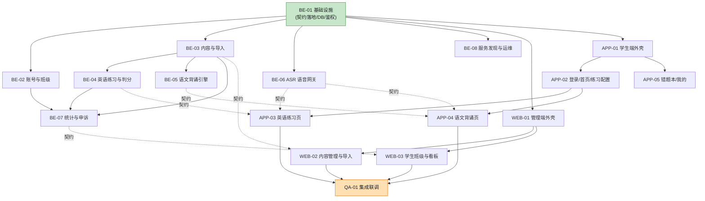

# 背记系统 开发总纲与任务分解

| 项目 | 内容 |
|---|---|
| 文档版本 | v1.0 |
| 编制日期 | 2026-09-23 |
| 关联文档 | 《背记系统需求说明书》v0.3、《背记系统数据库设计》v1.0、《背记系统接口设计》v1.0、《背记系统UI设计规范》v1.0 |
| 用途 | 把系统拆成可**独立开发、独立验收**的工作包，供多个 AI 子 Agent 并发执行 |

---

## 0. 这份文档怎么用

本文档是**开发阶段的唯一调度入口**。它的读者有两个：

1. **项目负责人（姚工）**：据此决定开发顺序、分派任务、判断哪个包可以先启动。
2. **执行开发的 AI 子 Agent**：领到自己的包后，按「本文档 §6 的启动协议」加载上下文，然后只读**本包规格 + 共享契约**，不要越界改别人的文件。

### 0.1 三层文档体系

| 层 | 文档 | 谁需要读 |
|---|---|---|
| 需求层 | 《背记系统需求说明书》 | 全员（作为验收依据） |
| 契约层 | **《01-共享契约冻结》** | **全员必读，且不得擅自变更** |
| **前置任务** | **《05-ASR 预研方案》** | **开发启动前必须完成；结论直接影响 BE-04 / BE-06 / APP-03 与需求 §6.2** |
| 执行层 | 《10/20/30-各端工作包规格》《40-集成与验收规格》 | 只读自己那一份 |

> 详细设计（数据库 DDL、接口列表、UI 规范）保持原样，作为契约层的事实来源，工作包规格只做**引用与补充**，不复制粘贴——避免两份文档说法不一致。

---

## 1. 拆分原则

拆分不是为了「看起来有条理」，是为了让多个 Agent 能真的同时动手且不打架。四条硬原则：

| # | 原则 | 具体做法 |
|---|---|---|
| 1 | **契约先行** | 数据库 Schema、HTTP 响应结构、WebSocket 消息、服务层函数签名，全部在开工前一次性冻结。任何人不得私自加字段、改路径、改枚举 |
| 2 | **文件独占** | 每个文件有且只有一个包拥有写权限。跨包协作一律通过**服务层函数**或**HTTP 接口**，绝不允许两个包改同一个文件 |
| 3 | **接口解耦** | 包与包之间依赖的是**函数签名**，不是实现。被依赖方还没实现时，调用方用 Mock 先跑通自己的逻辑 |
| 4 | **可独立验收** | 每个包都带一组可执行的验收用例，不依赖其他包是否完成（用 Mock / 种子数据自测） |

### 1.1 反面案例（这些做法会导致并发开发失败）

- ❌ 让两个包都去维护 `api/__init__.py` 的路由注册列表 → **改为自动发现机制**（见 §5.4）
- ❌ 统计包自己写一份「正确率」计算逻辑 → **必须复用判分引擎产出的 `match_type` 口径**
- ❌ 前端包自己拼 HTTP 请求 → **必须走共享 `apiClient`**，统一处理 `code != 0`
- ❌ 某个包需要新字段，直接改 `001_init.sql` → **必须新增 `00X_xxx.sql` 迁移**（见契约 §4.4）

---

## 2. 工作包总览

共 **17 个工作包**：后端 8 个、管理端 3 个、学生端 5 个、验收 1 个。

| 编号 | 名称 | 优先级 | 直接依赖 | 需求追溯 |
|---|---|---|---|---|
| **WP-BE-01** | 基础设施与契约骨架 | P0 | — | §2.2 §2.3 §11 |
| **WP-BE-02** | 账号与班级管理 | P1 | BE-01 | §3.1 §4.1 §4.2 §5.1 |
| **WP-BE-03** | 内容管理与 Excel 导入 | P0 | BE-01 | §4.3–§4.6 附录A |
| **WP-BE-04** | 英语练习与判分引擎 | P0 | BE-01、BE-03 | §5.3–§5.5 §5.8 §6.1 §6.2 §6.4 §6.5 |
| **WP-BE-05** | 语文背诵引擎 | P1 | BE-01、BE-03 | §5.6 §5.7 §6.3 §6.4 |
| **WP-BE-06** | ASR 语音网关 | P0 | BE-01 | §9 全章 |
| **WP-BE-07** | 统计看板与申诉复核 | P1 | BE-01、BE-02、BE-03、BE-04 | §4.7 §6.1(申诉) §9.6 |
| **WP-BE-08** | 服务发现与运维 | P0 | BE-01 | §10 全章 §11.4 |
| **WP-WEB-01** | 管理端外壳与登录 | P0 | BE-01 | §4.1 |
| **WP-WEB-02** | 内容管理与导入向导 | P0 | WEB-01、BE-03 | §4.3–§4.6 |
| **WP-WEB-03** | 学生班级与数据看板 | P1 | WEB-01、BE-02、BE-07 | §4.2 §4.7 §4.8 |
| **WP-APP-01** | 学生端外壳与基础设施 | P0 | BE-01、BE-08 | §5.1 §10 UI 规范 |
| **WP-APP-02** | 注册登录·首页·练习配置 | P0 | APP-01、BE-02、BE-03 | §5.1–§5.3 |
| **WP-APP-03** | 英语练习页 | P0 | APP-02、BE-04、BE-06 | §5.4 §5.5 §5.8 §6.1 §6.2 |
| **WP-APP-04** | 语文背诵页 | P1 | APP-02、BE-05、BE-06 | §5.6 §5.7 §6.3 |
| **WP-APP-05** | 错题本·我的·护眼提醒 | P2 | APP-01、BE-04 | §5.9 UI §6 |
| **WP-QA-01** | 集成联调与验收 | P0 | 全部 | §12.1 一期范围 |

> **优先级说明**：P0 = 缺了跑不通；P1 = 一期必须有但可稍后；P2 = 一期可延后到收尾。

---

## 3. 依赖关系图



图中**虚线**表示「只依赖冻结的契约（函数签名 / 接口结构），不依赖对方实现」——这意味着虚线两端的包可以**同时开工**，调用方用 Mock 自测即可。

---

## 4. 并发执行批次建议

### 批次 1 — 地基（必须先做，其他全部等它）

| 工作包 | 说明 |
|---|---|
| WP-BE-01 | 落地 §01 契约：目录骨架、迁移脚本（15 张表全建）、统一响应、鉴权、自动路由发现 |
| WP-WEB-01 | 可与 BE-01 并行，但前端需等 BE-01 的接口契约冻结（已在 §01 完成，可直接开工） |
| WP-APP-01 | 同上，主题体系与服务发现不依赖后端实现 |

**启动条件**：无。批次 1 的三个包可以同时开工。

### 批次 2 — 核心闭环（BE-01 验收通过后启动）

| 工作包 | 可并行说明 |
|---|---|
| WP-BE-02 账号与班级 | 独立 |
| WP-BE-03 内容与导入 | 独立 |
| WP-BE-04 英语练习与判分 | 依赖 BE-03 的**表结构**（已冻结），不依赖其代码，可并行 |
| WP-BE-05 语文背诵引擎 | 同上 |
| WP-BE-06 ASR 语音网关 | 只依赖 `JudgeService` / `ReciteEngine` 的**签名**（已冻结），可用 Mock 并行 |
| WP-BE-08 服务发现与运维 | 独立 |
| WP-WEB-02 内容管理与导入 | 依赖 BE-03 接口契约（已冻结），可并行 |
| WP-APP-02 登录/首页/配置 | 依赖 BE-02/03 契约（已冻结），可并行 |

> **本批次是并发的核心**：8 个包同时开工。前提是 §01 契约必须真正冻结完，一旦开工就不再改签名。

### 批次 3 — 语文与运营（批次 2 大部分验收通过后）

| 工作包 | 说明 |
|---|---|
| WP-BE-07 统计与申诉 | 需要 BE-02/03/04 的数据产生能力，联调更顺 |
| WP-WEB-03 学生班级与看板 | 需要 BE-07 |
| WP-APP-03 英语练习页 | 需要 BE-04 + BE-06 联调 |
| WP-APP-04 语文背诵页 | 需要 BE-05 + BE-06 联调 |
| WP-APP-05 错题本/我的 | 依赖面窄，也可提前到批次 2 |

### 批次 4 — 验收

| 工作包 | 说明 |
|---|---|
| WP-QA-01 | 全链路联调 + 验收矩阵执行 |

> **务实提醒**：批次只是「建议启动顺序」，不是硬约束。前端包只要契约在手，完全可以提前开工。真正卡人的只有 BE-01——它不落地，谁都没法跑。

---

## 5. 目录结构与文件归属矩阵

### 5.1 仓库总结构

```
bjsys/                                 # 项目根目录（名称可改）
├── docs/                              # 已有设计文档（只读，不在开发包范围内）
├── backend/                           # FastAPI 服务端
├── admin-web/                         # 管理端 Web（Vue 3 + Vite + Element Plus）
├── student-app/                       # 学生端（Flutter）
├── ops/                               # 部署脚本、服务注册、备份脚本
└── .workbuddy/                        # 项目记忆（不动）
```

### 5.2 后端文件归属

| 路径 | 归属包 | 说明 |
|---|---|---|
| `backend/app/main.py` | BE-01 | 应用入口、中间件装配、路由自动发现 |
| `backend/app/core/config.py` | BE-01 | 配置加载（.env + asr.yaml） |
| `backend/app/core/db.py` | BE-01 | SQLite 连接、PRAGMA、事务上下文 |
| `backend/app/core/security.py` | BE-01 | JWT 签发校验、bcrypt |
| `backend/app/core/response.py` | BE-01 | 统一响应包装 `ok()/fail()` |
| `backend/app/core/errors.py` | BE-01 | 错误码常量、业务异常类 |
| `backend/app/core/audit.py` | BE-01 | 审计日志写入 |
| `backend/app/core/excel.py` | BE-01 | 通用 xlsx 读写、模板生成 |
| `backend/app/core/preview_store.py` | BE-01 | `preview_token` 存储与过期（BE-02/BE-03 共用） |
| `backend/app/core/pagination.py` | BE-01 | 分页参数解析与校验 |
| `backend/app/core/idempotency.py` | BE-01 | 幂等键处理 |
| `backend/app/core/rate_limit.py` | BE-01 | 限流中间件 |
| `backend/app/core/deps.py` | BE-01 | `get_db` / `get_current_user` / `require_admin` |
| `backend/app/core/router_loader.py` | BE-01 | **自动路由发现**（见 §5.4） |
| `backend/app/migrations/001_init.sql` | BE-01 | 全量建表 + 视图（只写一次，永不修改） |
| `backend/app/migrations/00X_*.sql` | 各包自建 | 新增迁移由需要它的包创建，编号递增 |
| `backend/app/api/auth.py` | BE-02 | 登录/注册/me |
| `backend/app/api/classes.py` | BE-02 | 班级 CRUD |
| `backend/app/api/students.py` | BE-02 | 学生列表/导入/归班/重置密码 |
| `backend/app/api/units.py` | BE-03 | 单元 CRUD + 词条/课文读取（双角色） |
| `backend/app/api/words.py` | BE-03 | 词条改/停用/删 |
| `backend/app/api/texts.py` | BE-03 | 课文详情 |
| `backend/app/api/imports.py` | BE-03 | 模板下载 + preview/commit |
| `backend/app/api/sessions.py` | BE-04 | 开始/答题/结束 |
| `backend/app/api/me_profile.py` | BE-02 | `GET/PUT /api/me/profile`（信息、年级学期偏好） |
| `backend/app/api/me_learning.py` | BE-04 | `/api/me/units`、`/api/me/progress`、错题本、申诉提交 |
| `backend/app/api/recite.py` | BE-05 | 背诵流程 HTTP 接口 |
| `backend/app/api/asr_ws.py` | BE-06 | `/ws/asr` WebSocket |
| `backend/app/api/stats.py` | BE-07 | 班级/单元/学生统计 |
| `backend/app/api/appeals.py` | BE-07 | 申诉列表与复核 |
| `backend/app/api/discovery.py` | BE-08 | `/api/ping`、`/api/server/info` |
| `backend/app/services/judge/*` | BE-04 | 判分引擎（文本/拼读/归一化/差异对齐） |
| `backend/app/services/mastery_service.py` | BE-04 | 掌握度物化表维护（**被 BE-03 调用**） |
| `backend/app/services/session_service.py` | BE-04 | 组卷、场次结算 |
| `backend/app/services/recite/*` | BE-05 | 对齐算法、背诵引擎、评分 |
| `backend/app/services/asr/*` | BE-06 | ASRProvider、Aliyun/Volcengine/降级 |
| `backend/app/services/stats_service.py` | BE-07 | 统计聚合 |
| `backend/app/services/backup_service.py` | BE-08 | VACUUM INTO 备份 + 校验 |
| `backend/app/data/homophone_map.yaml` | BE-04 | 谐音映射表（A–Z 中英谐音） |
| `backend/app/schemas/*.py` | 按包分文件 | 每个包只写自己的 schema 文件 |
| `backend/app/tests/test_<包名>.py` | 按包分文件 | 每包自己的单测 |

### 5.3 管理端 / 学生端文件归属

| 路径 | 归属包 |
|---|---|
| `admin-web/src/main.ts`、`router/`、`api/client.ts`、`layouts/`、`views/Login.vue` | WEB-01 |
| `admin-web/src/views/content/**`、`api/content.ts` | WEB-02 |
| `admin-web/src/views/students/**`、`views/stats/**`、`views/server/**`、`api/students.ts`、`api/stats.ts` | WEB-03 |
| `student-app/lib/main.dart`、`core/theme/**`、`core/net/**`、`core/storage/**`、`core/discovery/**`、`features/auth/**` | APP-01 |
| `student-app/lib/features/home/**`、`features/config/**` | APP-02 |
| `student-app/lib/features/english/**` | APP-03 |
| `student-app/lib/features/recite/**` | APP-04 |
| `student-app/lib/features/mine/**` | APP-05 |

> **路由文件是并发雷区**：管理端 `router/index.ts` 由 WEB-01 拥有，但 WEB-02/03 需要注册自己的路由。解决办法：WEB-01 采用**路由模块自动聚合**——`router/routes/` 目录下每个文件导出路由数组，`index.ts` 用 Vite 的 `import.meta.glob` 聚合。WEB-02/03 各自新增 `routes/content.ts`、`routes/students.ts`，谁都不改 `index.ts`。

### 5.4 关键机制：自动路由发现（避免并发冲突）

**后端**：`core/router_loader.py` 扫描 `app/api/` 下所有模块，自动注册其中名为 `router` 的 `APIRouter` 对象。新增模块**无需修改任何注册文件**。

**管理端**：`router/index.ts` 用 `import.meta.glob('./routes/*.ts', { eager: true })` 聚合。新增页面**无需修改 index.ts**。

**Flutter**：`core/router/app_router.dart` 使用声明式路由表按 feature 拆分，由 APP-01 定义好占位，各 feature 包提供自己的 `routes` 常量列表；APP-01 的聚合器遍历收集。

> 这三个机制是并发开发能成立的技术前提，BE-01 / WEB-01 / APP-01 必须优先实现。

---

## 6. 子 Agent 启动协议

给每个 AI 子 Agent 派活时，按下面模板投喂上下文。**不要一次性把全部文档塞给它**，只给它需要的。

```text
【任务】开发 WP-XX-NN <包名称>

【必读上下文】
1. docs/dev/01-共享契约冻结.md        （全部，这是硬约束）
2. 按包取对应规格文件中的 «WP-XX-NN» 章节：
   - WP-BE-01 ~ 04 → docs/dev/10a-后端工作包规格（上）.md
   - WP-BE-05 ~ 08 → docs/dev/10b-后端工作包规格（下）.md
   - WP-WEB-01 ~ 03 → docs/dev/20-管理端工作包规格.md
   - WP-APP-01 ~ 05 → docs/dev/30-学生端工作包规格.md
   - WP-QA-01 → docs/dev/40-集成与验收规格.md
3. 需要时查阅：docs/背记系统数据库设计.md、docs/背记系统接口设计.md、
   docs/背记系统UI设计规范.md（学生端包必读）

【工作目录】见规格中「独占文件清单」，只允许创建/修改清单内的文件。

【交付要求】
- 所有功能点实现完毕（规格中「功能点详述」逐条可勾选）
- 通过本包「验收用例」全部条目
- 提供测试脚本 backend/app/tests/test_<包名>.py 或等价物
- 不改动其他包的独占文件；如需变更共享契约，停下来报告，不要自作主张

【完成时输出】
- 变更文件清单
- 验收用例执行结果
- 遗留问题与阻塞项
```

### 6.1 变更管理（重要）

契约一旦冻结，**任何包都不得单方面修改**。如果开发中发现契约有问题（比如某个接口缺字段），走这个流程：

1. 停止开发该部分，记录问题（需要什么、为什么现有契约不够）
2. 提交给项目负责人（姚工）确认
3. 确认后**统一更新 §01 契约文档**，并通知所有受影响的工作包
4. 受影响包更新自己的实现与 Mock

> 禁止「我先改了自己这半边，反正对面应该也这么改」——这是并发开发翻车的第一大原因。

---

## 7. 集成与联调顺序

各包独立自测通过后，按**依赖链**逐步联调，不要一次全上：


| 阶段 | 涉及包 | 通过标准 |
|---|---|---|
| ① 冒烟 | BE-01、WEB-01、APP-01、BE-08 | 服务启动无错；管理端能登录；App 能扫码/发现并连上服务器 |
| ② 内容 | BE-03、BE-02、WEB-02、BE-07(部分) | Excel 导入 → 预览 → 确认 → 列表可见 → 学生端能拉到 |
| ③ 英语 | BE-04、BE-06、APP-02、APP-03 | 组卷→说词→拼读→逐字母回显→落库→错题本可见 |
| ④ 语文 | BE-05、BE-06、APP-04 | 背诵→逐字点亮→提示→结算页回看 |
| ⑤ 统计 | BE-07、WEB-03 | 班级概览、单元掌握度、个人报告、申诉复核 |
| ⑥ 端到端 | QA-01 | 验收矩阵全绿 |

---

## 8. 完成定义（DoD）

一个工作包算「完成」，必须同时满足：

- [ ] 规格中「功能点详述」逐条实现，无遗漏、无「先 TODO 回头补」
- [ ] 「验收用例」全部通过，且**用例脚本可重复执行**
- [ ] 未修改任何非本包独占文件（`git status` 可核对）
- [ ] 未擅自变更共享契约
- [ ] 错误处理覆盖：参数校验、权限、资源不存在、下游超时（涉及外部依赖的包）
- [ ] 关键路径有日志（错误必须带 `trace_id`）
- [ ] 交付时输出：变更文件清单 + 验收结果 + 遗留问题

**以下情况不算完成**：

- ❌ 用 `print` 代替日志
- ❌ 测试靠手工点，没有可执行脚本
- ❌ 硬编码了本该配置的值（如密钥、IP、阈值）
- ❌ 为了让测试通过而放宽断言，而不是修实现

---

## 9. 已知阻塞点与风险

| # | 风险 | 影响包 | 处理方式 |
|---|---|---|---|
| 1 | **云 ASR 对孤立字母识别率未知** | BE-04、BE-06、APP-03 | 判分的相似度阈值、谐音表规模都依赖实测。**建议开发前先做预研**（需求 §13.1），结果可能调整 §6.2 规则 |
| 2 | 火山引擎需企业实名认证 | BE-06 | 一期以阿里云为主，火山只做配置预留，不阻塞 |
| 3 | 拼音转换库选型（`pypinyin`） | BE-03 | 必须在契约层定死库与版本，否则 `content_pinyin` 生成结果不一致会导致对齐错位 |
| 4 | 语文对齐算法的调参 | BE-05 | 窗口大小、噪声阈值都是经验值，需真实语料校准；接口设计已留出可配置项 |
| 5 | 前端契约变更传导 | 全部前端包 | 严格走 §6.1 变更流程 |

---

## 10. 附录：工作包状态跟踪表

开发过程中用这张表跟踪进度。**2026-09-25 更新：17 个包全部完成并独立复跑通过**（下表已回填最后 5 个包：WEB-03 / APP-03 / APP-04 / APP-05 / QA-01）。

| 工作包 | 负责人/Agent | 状态 | 完成日期 | 备注 |
|---|---|---|---|---|
| WP-BE-01 | | ✅ 已完成 | 2026-09-23 | 迁移 15 张表、统一响应、鉴权、限流/幂等/异常处理、自动路由发现、`/api/health`。`pytest` 13 个用例绿。⚠️ 遗留：限流实际按 **IP** 计数（`RateLimitMiddleware` 是纯 ASGI 中间件，读不到请求体里的 `username`），与契约 §5.4「单账号」表述不一致，待上报 |
| WP-BE-02 | | ✅ 已完成 | 2026-09-23 | 账号与班级管理（U1–U14）。`pytest` 26 个用例绿；真机烟测 `scripts/smoke_be02.py` **32/32** 绿。⚠️ 3 处偏离已上报（见交付说明） |
| WP-BE-03 | | ✅ 已完成 | 2026-09-24 | 内容管理与 Excel 导入（F1–F17，U1–U19 全覆盖）。`pytest` 45 个用例绿；真机烟测 `scripts/smoke_be03.py` **40/40** 绿。⚠️ 5 处偏离已上报（见交付说明）；另修复 BE-01 的 `main.py` 模块级 `settings` 快照缺陷 |
| WP-BE-04 | | ✅ 已完成 | 2026-09-24 | 英语练习与判分引擎（F1–F20，U1–U28 全覆盖）。`pytest` **125** 个用例绿（判分 72 + 练习流程 53）；真机烟测 `scripts/smoke_be04.py` **60/60** 绿（从 Excel 导入到结算的**全链路**）。⚠️ **9** 处偏离已上报（见 `02-实现约定与复用经验.md` §八） |
| WP-BE-05 | | ✅ 已完成 | 2026-09-24 | 语文背诵引擎（对齐 + 逐字点亮 + 提示 + 结算）。`pytest` **86** 个用例绿（对齐 26 + 引擎 60）；真机烟测 `scripts/smoke_be05.py` **49/49** 绿。同时补齐**契约 §9.1 缺失的语文场次**链路（`POST /api/sessions` 原本只定义英语）。⚠️ **7** 处偏离已上报（见 `02-实现约定与复用经验.md` §八） |
| WP-BE-06 | | ✅ 已完成 | 2026-09-24 | ASR 语音网关（F1–F19，U1–U16 全覆盖）。`pytest` **78** 个用例绿（Provider/工厂/主备/仲裁 46 + WebSocket 会话 32）；真机烟测 `scripts/smoke_be06.py` **26/26** 绿（真 uvicorn + **真 TCP WebSocket**：握手 4001、word/spell 全流程、空结果、超时、非法音频、并发闸门、踢旧连接、重连补发、无音频落盘、`asr_logs` 落库）。新增 `backend/asr.yaml(.example)`。⚠️ **7** 处偏离已上报（见 `02-实现约定与复用经验.md` §八）；⛔ **DoD 未闭合项**：`AliyunProvider` 真实云账号联调（当前无可用凭证） |
| WP-BE-07 | | ✅ 已完成 | 2026-09-25 | 统计看板 + 错题榜 + 申诉复核 + ASR 用量 + 每日归集（F1–F3 / F6 / F7 / F9 / F10 / F11；U1–U13 全覆盖）。`pytest` **34** 个用例绿；真机烟测 `scripts/smoke_be07.py` **56/56** 绿（真 uvicorn + 独立进程造数 + 真 HTTP；含北京时间日界、xlsx 导出用 openpyxl 反向解析）。产出：`schemas/stats.py`、`services/stats_service.py`、`services/asr_stats_service.py`、`tasks/asr_daily_rollup.py`、`api/stats.py`、`api/appeals.py`。⚠️ **7** 处偏离已上报（`02-实现约定与复用经验.md` §八 #50–#56） |
| WP-BE-08 | | ✅ 已完成 | 2026-09-25 | 服务发现 + 运维部署（F1–F4 / F9 / F12 / F13）。`pytest` **28** 个用例绿；真机烟测 `scripts/smoke_be08.py` **40/40** 绿（真 uvicorn + **真 UDP socket 广播往返**；含 `/api/ping` 归属校验、管理端手动备份的文件+完整性+秒级文件名）。产出：`services/discovery/*`（`netinfo` / `udp_responder` / 运行期状态）、`api/discovery.py`、`services/backup_service.py`、`tasks/scheduler.py`、`ops/*`（`install_service.ps1` / `uninstall_service.ps1` / `backup.bat` / `README.md` 部署手册）。⚠️ **5** 处偏离已上报（§八 #57–#61）；**另修正 BE-01 的 `/api/ping` 路由遮蔽隐患**（#41 的后续，已删桩） |
| WP-WEB-01 | | ✅ 已完成 | 2026-09-23 | 管理端外壳与登录（F1–F10）。真机联调烟测 `admin-web/scripts/smoke_web01_login.mjs` **15/15** 绿（真 Edge headless + 真 vite + 真后端）。⚠️ U7 无 UI 触发点，用法待补（见脚本头说明） |
| WP-WEB-02 | | ✅ 已完成 | 2026-09-25 | 管理端内容管理（单元 / 词条 / 课文 / 三步式导入向导，F1–F12）。真机联调烟测 `admin-web/scripts/smoke_web02_content.mjs` **14/15 PASS**（真 Edge headless + CDP + 真 vite + 真后端；`W13 错误报告下载` 为本轮**复核新增**用例；1 个 SKIP 是已在脚本头文档化的 F3 `30003` 分支，需学生端产生练习记录）。`vue-tsc --noEmit` 与 `vite build` 均干净。产出：`views/content/*`（`UnitList` / `UnitDetail` / `WordTable` / `WordEditDialog` / `TextTable` / `ImportWizard` + `steps/*` 四步）、`api/content.ts`、`api/imports.ts`、路由 `content/*`。⚠️ **3** 处偏离已上报（§八 #62–#64），其中 **#63 是复核时抓到的真实缺陷**（`error_report_url` 与 `baseURL='/api'` 叠加成 `/api/api/...` → 404，原烟测只断言"非法行已列出"、**没真下载**，所以漏掉了） |
| WP-WEB-03 | | ✅ 已完成 | 2026-09-25 | 学生班级与数据看板（班级/学生管理 + 学生导入向导 + 重置密码 + 班级概览/单元掌握/学生报告/申诉复核 + 服务地址与二维码，F1–F12）。`vue-tsc --noEmit` 与 `vite build` 干净；真机联调烟测 `admin-web/scripts/smoke_web03_stats.mjs` **17/18 PASS**（真 Edge headless + CDP + 真 vite + 真后端；唯一 SKIP `U13x` = 手机真扫码，人工项）→ 证据 `qa/smoke_web03_verify.txt`。⚠️ 如实降级：申诉复核**不能试听录音**（一期不保存音频，见清单 B3） |
| WP-APP-01 | | ✅ 已完成 | 2026-09-24 | 学生端外壳与基础设施（F1–F15，U1–U15 全覆盖）。`flutter test` **122** 个用例绿（主题/分龄 26 + 服务发现 22 + 网络 34 + 媒体 20 + 外壳 20）；`flutter analyze` **0 issue**；真机联调 `student-app/scripts/smoke_app01.py` **11/11** 绿（真 uvicorn + 真 HTTP：探活契约字段、注册字段名、`AuthController` 生产路径落库 + restore、20001/20002 防枚举、10002 过期钩子、数字查询参数、404 文案）。产出：三套护眼主题 + 分龄档位（对比度用**可执行单测**钉死）、服务发现三路径（UDP 广播 / 扫码 `bjsys://` / 手输 + 最近地址）、统一 HTTP 客户端、`/ws/asr` WebSocket 客户端、16k PCM 录音与 150ms 切片、护眼 20-20-20、路由聚合（APP-02~05 已留空壳占位）、Android 权限清单。⚠️ **7** 处偏离已上报（见 `02-实现约定与复用经验.md` §八 #34–#40）；**另发现 BE-01 缺陷 1 处**（#41：`/api/ping` 违反契约 §3.1，且其桩会**遮蔽 BE-08 的路由**） |
| WP-APP-02 | | ✅ 已完成 | 2026-09-24 | 注册登录·首页·练习配置（F1–F15，U1–U11 全覆盖）。`flutter test` **96** 个用例绿（模型/时间与预估 62 + 首页/引导 18 + 配置页 16；全项目 **218** 绿、`analyze` **0 issue**）；真机联调 `student-app/scripts/smoke_app02.py` **17/17** 绿（真 uvicorn + **Excel 造数** + 真 HTTP：`/api/me/units` 英语/语文双形态字段、`§8.3` 不下发 `with_error`、`subject` 过滤、`/api/me/progress`、`/api/me/wrong-words` 只取 `total`、学生视图**不含 `accepted`**、课文摘要不含正文、组卷 `strategy` 字段名逐个核对、`range/lesson/wrong` 三档 `scope_detail` 真生效、**答错一题→错题数 1→`scope=wrong` 出 1 题**、断网降级 vs 10002 不走缓存）。产出：`features/home/*`（数据层 + 仓库 + 控制器 + P4 卡片族 + 年级学期强制引导 + 主壳底部导航 + 单元详情）、`features/config/*`（五维策略模型 + 纯函数时长预估 + 配置页 + 发起练习 + 语文选课文）、路由接管 `/home`（APP-01 空壳填满）。⚠️ **7** 处偏离已上报（`02-实现约定与复用经验.md` §八 #42–#48），其中 **#46 是真机烟测抓到的 APP 侧真实缺陷**（语文组卷发 `mode:'recite'` 被 Pydantic 拦成 10001，**语文练习整条链路发不出去**），**#47 暴露契约文档自身矛盾**（§8.6 与 §8.7/§9.4 的 `total_chars` 定义不一致） |
| WP-APP-03 | | ✅ 已完成 | 2026-09-25 | 英语练习页（显示题目 → 说词 → 拼读 → **逐字母差异回显** → 结算；**语音优先**、键盘仅第 3 次失败才降级、留痕 `used_keyboard`；组卷响应不返回答案）。真机烟测 `student-app/scripts/smoke_app03.py` **6 通过 / 0 跳过**（本轮首次真正跑通）→ 证据 `qa/smoke_app03_verify.txt`；接管 `/practice` 路由（复用 APP-01 占位文件，未新建 `english.dart`） |
| WP-APP-04 | | ✅ 已完成 | 2026-09-25 | 语文背诵页（**逐字点亮**、当前位置空框、三档提示、结算；进入课文不显示正文）。真机烟测 `student-app/scripts/smoke_app04.py` **15 通过 / 0 跳过**，含**真 WS `/ws/asr` `task_type=recite`** 链路（partial 帧真推进服务端 `pos`）→ 证据 `qa/smoke_app04_verify_indep.txt`；接管 `/recite`。⚠️ 真机抓到 **1 个客户端真实缺陷并已修**：`newly_matched` 服务端下发**位置数组**，客户端 `_toInt()` 恒得 0（假适配器测试永远绿）→ §八 #66 |
| WP-APP-05 | | ✅ 已完成 | 2026-09-25 | 错题本·我的·护眼提醒（错题本 + 我的记录/统计 + 申诉 + 主题与护眼设置）。真机烟测 `student-app/scripts/smoke_app05.py` **10 通过 / 0 跳过** → 证据 `qa/smoke_app05_verify4.txt`：含 `GET /api/sessions` 列表 + `/{id}` 的 **`ongoing → 10003` 防泄题线**（结算后才给 `expected`），以及 **A5 语文错题本**（§8.10：真背 2 遍课文各漏「霜」→ `wrong_count=2`、`first_pos=9`、上下文与正文逐字核对；「重背这篇」走生产 `toRequest()`）。接管 `/mistakes`。**语文错题本已于 2026-09-25 补齐**（§八 #48 已解决），一期 A 档缺口清零 |
| WP-QA-01 | | ✅ 已完成 | 2026-09-25 | 集成与验收收口。端到端冒烟 `qa/smoke/smoke_core.py` **39/39**；`qa/e2e/` 场景 **12/12** + prepare 3/3 + verify 5/5；**非功能 18/18**（`qa/perf_nonfunc_2026-09-25.txt`）+ 缺口补验 **8/8**（`qa/perf_gaps_2026-09-25.txt`）→ 均见 `qa/smoke_qa01_run7.txt` / `qa/e2e_qa01_run2.txt`。`docs/dev/40-集成与验收规格.md` §5.1/§5.2 矩阵**已回填**（原 50 条全 `☐`） |
