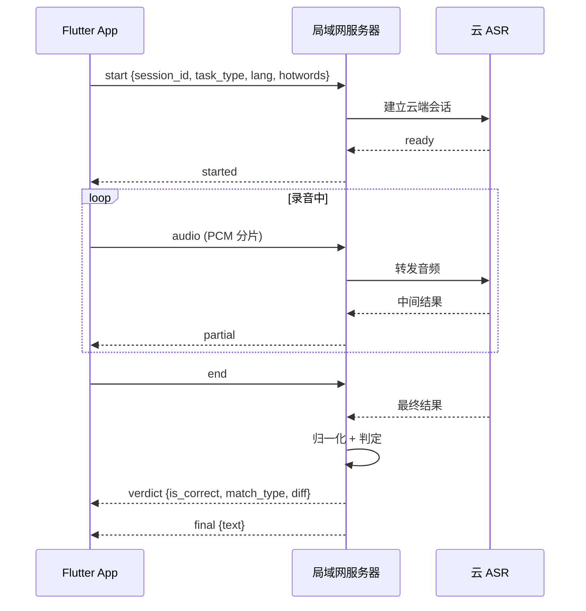

# 背记系统 接口设计

| 项目 | 内容 |
|---|---|
| 文档版本 | v1.0 |
| 编制日期 | 2026-09-23 |
| 关联文档 | 《背记系统需求说明书》v0.2、《背记系统数据库设计》v1.0 |
| 协议 | HTTP/1.1 + WebSocket + UDP |

---

## 1. 通用规范

### 1.1 基础约定

| 项 | 约定 |
|---|---|
| Base URL | `http://{host}:{port}/api` |
| 编码 | UTF-8 |
| 请求体 | `application/json`（文件上传用 `multipart/form-data`） |
| 时间格式 | ISO 8601 UTC，如 `2026-09-23T10:11:29Z` |
| 认证 | `Authorization: Bearer {jwt}` |
| 分页参数 | `page`（从 1 起）、`page_size`（默认 20，上限 100） |
| 排序参数 | `sort_by`、`sort_order`（`asc` / `desc`） |
| 幂等 | 写操作支持 `Idempotency-Key` 头，防重复提交 |

### 1.2 统一响应结构

**成功**

```json
{
  "code": 0,
  "message": "ok",
  "data": { },
  "trace_id": "8f3a2b1c9d0e"
}
```

**失败**

```json
{
  "code": 40003,
  "message": "第 7 行数据校验失败：年级必须为 1-9",
  "data": null,
  "trace_id": "8f3a2b1c9d0e"
}
```

**分页响应**

```json
{
  "code": 0,
  "message": "ok",
  "data": {
    "items": [],
    "total": 128,
    "page": 1,
    "page_size": 20
  },
  "trace_id": "8f3a2b1c9d0e"
}
```

**HTTP 状态码使用**

| 状态码 | 场景 |
|---|---|
| 200 | 业务成功（含业务级失败，靠 `code` 区分） |
| 400 | 请求格式错误 |
| 401 | 未登录 / Token 失效 |
| 403 | 无权限 |
| 404 | 路径不存在 |
| 413 | 上传文件过大 |
| 429 | 请求过于频繁 |
| 500 | 服务端异常 |

> 业务错误统一返回 200 + 非零 `code`，便于前端统一拦截处理。`trace_id` 用于日志排查，**前端在错误提示中应携带该 ID**，方便用户反馈问题。

### 1.3 错误码表

| 区间 | 模块 |
|---|---|
| 0 | 成功 |
| 10000–19999 | 通用 |
| 20000–29999 | 账号与班级 |
| 30000–39999 | 内容 |
| 40000–49999 | 导入 |
| 50000–59999 | 语音 |
| 60000–69999 | 服务发现 |

| 错误码 | 含义 | 前端建议处理 |
|---|---|---|
| 10001 | 参数校验失败 | 提示具体字段 |
| 10002 | 未登录 / Token 无效 | 跳转登录页 |
| 10003 | 无权限 | 提示无权限 |
| 10004 | 资源不存在 | 提示并刷新列表 |
| 10005 | 请求过于频繁 | 提示稍后重试 |
| 10006 | 服务端内部错误 | 提示并展示 `trace_id` |
| 20001 | 用户名 / 学号已存在 | 注册页提示「请直接登录」 |
| 20002 | 用户名或密码错误 | 提示，不做「用户不存在」区分 |
| 20003 | 账号已被停用 | 提示联系管理者 |
| 20004 | 班级不存在 / 已归档 | 刷新班级列表 |
| 30001 | 单元不存在 | 刷新 |
| 30002 | 词条 / 课文不存在 | 刷新 |
| 30003 | 内容已有练习记录，不可删除 | 提示改为停用，**这是设计约束不是错误** |
| 30004 | 内容已停用 | 从列表移除 |
| 40001 | 文件格式错误（非 xlsx） | 提示重新上传 |
| 40002 | 模板列缺失 | 提示下载最新模板 |
| 40003 | 数据校验失败 | 展示错误行明细，允许下载错误报告 |
| 40004 | 文件过大 | 提示拆分导入 |
| 50001 | 语音服务不可用 | 提示切换键盘输入 |
| 50002 | 语音识别超时 | 提示重试或切键盘 |
| 50003 | 语音识别返回为空 | 提示「没听清，再说一次」，**不计错** |
| 50004 | 音频格式不支持 | 提示客户端问题（内部错误） |
| 60001 | 服务发现失败 | 引导扫码 / 手动输入 |

---

## 2. 认证

### 2.1 POST /api/auth/login — 登录

**请求**

```json
{
  "username": "20260001",
  "password": "123456",
  "role": "student"
}
```

| 字段 | 类型 | 必填 | 说明 |
|---|---|---|---|
| `username` | string | 是 | 学号或用户名 |
| `password` | string | 是 | 密码 |
| `role` | string | 是 | `admin` / `student`，用于隔离两端入口 |

**响应**

```json
{
  "code": 0,
  "data": {
    "token": "eyJhbGciOi...",
    "expires_in": 43200,
    "user": {
      "id": 1024,
      "role": "student",
      "username": "20260001",
      "real_name": "张小明",
      "class_id": 3,
      "class_name": "三年级二班",
      "preferred_grade": 3,
      "preferred_semester": "first"
    }
  }
}
```

**说明**

- 连续 5 次密码错误，锁定该账号 10 分钟，返回 `10005`。
- 学生登录时若 `preferred_grade` 为空，前端进入年级学期选择引导（见《UI 设计规范》§6.1）。

### 2.2 POST /api/auth/register — 学生自主注册

**请求**

```json
{
  "username": "20260088",
  "real_name": "李小红",
  "password": "123456",
  "class_id": 3
}
```

| 字段 | 类型 | 必填 | 说明 |
|---|---|---|---|
| `username` | string | 是 | 4–20 位，字母数字，全校唯一 |
| `real_name` | string | 是 | 1–20 字 |
| `password` | string | 是 | 6–20 位，允许纯数字弱口令 |
| `class_id` | integer | 否 | 不填则进入「未分班」状态 |

**响应**

```json
{
  "code": 0,
  "data": {
    "token": "eyJhbGciOi...",
    "expires_in": 43200,
    "user": { "id": 1025, "username": "20260088", "real_name": "李小红", "class_id": 3 }
  }
}
```

**说明**

- **注册成功直接签发 Token，无需审核**。
- 学号已存在返回 `20001`，前端提示「该学号已存在，请直接登录或联系管理者重置密码」，**不覆盖已有账号**。

### 2.3 GET /api/auth/me — 当前用户信息

返回当前登录用户的完整信息，用于 App 冷启动校验 Token 有效性。

---

## 3. 服务发现

### 3.1 GET /api/ping — 探活（免鉴权）

**响应**

```json
{
  "code": 0,
  "data": {
    "service": "bjsys",
    "version": "1.0.0",
    "server_name": "背记系统",
    "time": "2026-09-23T10:11:29Z"
  }
}
```

### 3.2 UDP 广播发现协议

| 项 | 约定 |
|---|---|
| 端口 | `9527` |
| 广播地址 | `255.255.255.255` |
| 超时 | 客户端等待 2 秒，可重试 2 次 |
| 编码 | UTF-8 JSON |

**客户端探测包**（App → 广播地址）

```json
{ "magic": "BJSYS_DISCOVER", "v": 1 }
```

**服务端应答**（服务器 → 单播回客户端）

```json
{
  "magic": "BJSYS_HERE",
  "v": 1,
  "host": "192.168.1.80",
  "port": 8810,
  "server_name": "背记系统",
  "need_auth": false
}
```

**安全约束**

- 服务器只响应局域网内私有地址段的请求，拒绝公网来源。
- 应答包只暴露 host / port / 服务名，**不含任何敏感信息**。
- 该端口仅用于发现，不做任何写操作。

### 3.3 GET /api/server/info — 服务地址信息（管理端）

**响应**

```json
{
  "code": 0,
  "data": {
    "addresses": [
      { "iface": "以太网", "ip": "192.168.1.80", "recommended": true },
      { "iface": "WLAN",   "ip": "192.168.1.92", "recommended": false }
    ],
    "port": 8810,
    "current_url": "http://192.168.1.80:8810",
    "qr_content": "bjsys://192.168.1.80:8810",
    "broadcast_enabled": true,
    "last_ip_change_at": "2026-09-20T08:12:00Z"
  }
}
```

**说明**

- 管理端首页据此渲染二维码。`ip` 变化时 `last_ip_change_at` 更新，前端给出提示。

---

## 4. 班级与学生管理（管理端）

### 4.1 GET /api/classes — 班级列表

**查询参数**：`grade`、`semester`、`status`、`keyword`

**响应**

```json
{
  "code": 0,
  "data": {
    "items": [
      {
        "id": 3,
        "name": "三年级二班",
        "grade": 3,
        "semester": "first",
        "student_count": 42,
        "unassigned_count": 0,
        "created_at": "2026-09-01T02:00:00Z"
      }
    ],
    "total": 1, "page": 1, "page_size": 20
  }
}
```

**补充：`GET /api/classes/options` — 班级选项清单（注册页用，免鉴权）**

注册发生在**学生登录之前**，所以这个列表不能要求鉴权 —— 否则注册页永远拉不到班级，
UI 规范 §7.3「班级选择用卡片列表」就只能永远显示「先不选」。

```json
{
  "code": 0,
  "data": {
    "items": [
      { "id": 3, "name": "三年级二班", "grade": 3, "semester": "first" }
    ],
    "total": 6
  }
}
```

| 项 | 说明 |
|---|---|
| 鉴权 | **免鉴权**（与 §3.1 `/api/ping` 同级）—— 注册前没有身份可用 |
| 字段 | 只有 `id` / `name` / `grade` / `semester`；**不含** `student_count`、`unassigned_count`、备注、归档状态 |
| 范围 | 只返回 `status='active'`（已归档的班不再接收新学生） |
| 参数 | `grade` / `semester` 可选筛选；不分页，一次给全（班级量级很小） |
| 与 §4.1 的关系 | §4.1 是**管理端**接口（`require_admin`，带统计字段）；本条是**注册辅助**，两者不共用响应结构 |
| 失败不阻断注册 | 拉不到（网络 / 服务端异常）时注册页退回「先不选」；`class_id` 在 §2.2 本就是可选字段 |

### 4.2 POST /api/classes — 创建班级

```json
{ "name": "三年级二班", "grade": 3, "semester": "first", "school_year": "2026-2027" }
```

### 4.3 GET /api/students — 学生列表

**查询参数**：`class_id`、`status`、`register_source`、`keyword`、分页参数

**响应**

```json
{
  "code": 0,
  "data": {
    "items": [
      {
        "id": 1024, "username": "20260001", "real_name": "张小明",
        "class_id": 3, "class_name": "三年级二班",
        "register_source": "import", "status": "active",
        "last_login_at": "2026-09-23T09:01:00Z",
        "practice_count": 37, "accuracy": 0.86
      }
    ],
    "unassigned_count": 5,
    "total": 42, "page": 1, "page_size": 20
  }
}
```

### 4.4 POST /api/students/import — 批量导入学生

**请求**：`multipart/form-data`，字段 `file`（xlsx）

**预览响应**（先校验，不落库）

```json
{
  "code": 0,
  "data": {
    "preview_token": "pv_9f3a2b1c",
    "summary": { "total": 45, "valid": 43, "invalid": 2, "duplicated": 1 },
    "invalid_rows": [
      { "row": 7,  "reason": "学号重复（已存在 userId=1024）", "raw": ["20260001", "张小明"] },
      { "row": 13, "reason": "姓名不能为空", "raw": ["20260013", ""] }
    ],
    "error_report_url": "/api/import/report/pv_9f3a2b1c"
  }
}
```

**确认入库**

```
POST /api/students/import/commit
{ "preview_token": "pv_9f3a2b1c", "default_password": "123456" }
```

**响应**

```json
{
  "code": 0,
  "data": {
    "created": 43, "updated": 0,
    "credentials_url": "/api/classes/3/students/credentials"
  }
}
```

**说明**

- **两步式：先 `preview` 后 `commit`**，`preview_token` 有效期 30 分钟，防止「校验通过直接入库」。
- 同一学号重复导入时为**更新**而非新增。
- 未填初始密码时使用 `default_password`，可一键导出对照表。

### 4.5 POST /api/students/{id}/assign-class — 单个归班

```json
{ "class_id": 3 }
```

### 4.6 POST /api/students/batch-assign-class — 批量归班

```json
{ "student_ids": [1025, 1026, 1027], "class_id": 3 }
```

### 4.7 POST /api/students/{id}/reset-password — 重置密码

```json
{ "new_password": "123456" }
```

### 4.8 PATCH /api/students/{id} — 修改学生信息

```json
{ "real_name": "李小红", "status": "disabled", "class_id": null }
```

---

## 5. 内容管理（管理端）

### 5.1 GET /api/units — 单元列表

**查询参数**：`subject`、`grade`、`semester`、`status`、分页参数

**响应**

```json
{
  "code": 0,
  "data": {
    "items": [
      {
        "id": 11, "subject": "english", "grade": 3, "semester": "first",
        "name": "Unit 1 Hello!", "order_no": 1, "status": "active",
        "word_count": 24, "text_count": 0,
        "active_word_count": 22, "active_text_count": 0
      }
    ],
    "total": 12, "page": 1, "page_size": 20
  }
}
```

### 5.2 POST /api/units — 新建单元

```json
{ "subject": "english", "grade": 3, "semester": "first", "name": "Unit 1 Hello!", "order_no": 1 }
```

### 5.3 PATCH /api/units/{id} — 修改单元

```json
{ "name": "Unit 1 Hello", "order_no": 2, "status": "inactive" }
```

### 5.4 DELETE /api/units/{id} — 删除单元

**约束**：单元下任一内容有答题记录时返回 `30003`，提示改为停用。

### 5.5 GET /api/units/{id}/words — 词条列表

**查询参数**：`status`、`keyword`、分页参数

### 5.6 PATCH /api/words/{id} — 修改词条

```json
{
  "en": "classroom", "cn": "教室",
  "accepted": ["课室"], "type": "word", "require_spell": 1, "phonetic": "/ˈklɑːsruːm/"
}
```

**响应说明**：若该词条已有答题记录，响应中附带提示字段 `history_affected: true`，前端弹出确认。

### 5.7 POST /api/words/batch-status — 批量启用 / 停用

```json
{ "word_ids": [101, 102, 103], "status": "inactive" }
```

### 5.8 DELETE /api/words/{id} — 删除词条

**约束**：无答题记录时才允许；有记录返回 `30003`。

**响应（有记录时）**

```json
{
  "code": 30003,
  "message": "该词条已有 37 条练习记录，为保证统计完整只能停用",
  "data": { "record_count": 37 }
}
```

---

## 6. 内容导入

### 6.1 GET /api/import/template/{type} — 下载模板

`type`：`words` / `texts`。返回 xlsx 文件流，模板含**数据有效性下拉**（学科、年级、学期、类型）。

### 6.2 POST /api/import/words/preview — 英语词条导入校验

**请求**：`multipart/form-data`，字段 `file`

**响应**

```json
{
  "code": 0,
  "data": {
    "preview_token": "pv_7a2f1b",
    "summary": { "total": 120, "valid": 118, "invalid": 2 },
    "new_units": [ { "subject": "english", "grade": 3, "semester": "first", "name": "Unit 5" } ],
    "valid_rows": [
      { "row": 2, "subject": "english", "grade": 3, "semester": "first",
        "unit_name": "Unit 5", "type": "word", "en": "apple", "cn": "苹果" }
    ],
    "invalid_rows": [
      { "row": 12, "reason": "年级 10 超出范围（1-9）" },
      { "row": 45, "reason": "类型「词组」非法，应为 单词/短语/句子" }
    ],
    "error_report_url": "/api/import/report/pv_7a2f1b"
  }
}
```

**`valid_rows` 字段说明**（与 `invalid_rows` 对称：预览就是把「将入库什么」摆给管理者看）

| 字段 | 说明 |
|---|---|
| `row` | 原文件行号（含表头偏移，与 `invalid_rows.row` 同口径） |
| `subject` / `grade` / `semester` | 归一化后的值（不是用户填的原文） |
| `unit_name` / `type` / `en` / `cn` | 词条关键字段 |

- **只给关键字段**：不含 `accepted`（可接受答案，最多 20 条/词）、例句、音标、词性等长字段 ——
  预览页要的是「这一行会不会进去、进去长什么样」，明细体积必须可控。
- 顺序与文件一致；`valid_rows.length == summary.valid`（截断会让这个等式失效，故**不截断**）。

### 6.3 POST /api/import/words/commit — 英语词条确认入库

```json
{
  "preview_token": "pv_7a2f1b",
  "create_missing_units": true,
  "on_duplicate": "overwrite"
}
```

| 字段 | 说明 |
|---|---|
| `create_missing_units` | 单元不存在时是否自动创建（前端先弹确认） |
| `on_duplicate` | `overwrite` 覆盖 / `skip` 跳过 |

### 6.4 POST /api/import/texts/preview — 课文导入校验

**响应**

```json
{
  "code": 0,
  "data": {
    "preview_token": "pv_5c8d2e",
    "summary": { "total": 6, "valid": 6, "invalid": 0 },
    "texts": [
      {
        "row": 2, "title": "背影", "author": "朱自清",
        "paragraphs": [
          { "idx": 0, "text": "我与父亲不相见已二年余了，我最不能忘记的是他的背影。", "chars": 24, "recite": true },
          { "idx": 1, "text": "那年冬天，祖母死了……", "chars": 31, "recite": true }
        ],
        "recite_scope": [0, 1],
        "total_chars": 55,
        "pinyin_check": "ok"
      }
    ]
  }
}
```

**说明**

- `paragraphs` 回传后，前端**按段落渲染并允许管理者勾选背诵范围**，避免在 Excel 里手工算段落号出错。
- `pinyin_check` 用于校验「纯字序列与拼音序列等长」，`mismatch` 时拒绝入库。

### 6.5 POST /api/import/texts/commit — 课文确认入库

```json
{
  "preview_token": "pv_5c8d2e",
  "texts": [
    { "row": 2, "recite_scope": [0, 1] }
  ]
}
```

允许在 commit 阶段回传调整后的背诵范围。

---

## 7. 数据统计（管理端）

### 7.1 GET /api/stats/class/{id} — 班级概览

**查询参数**：`date_from`、`date_to`（默认近 7 天）

**响应**

```json
{
  "code": 0,
  "data": {
    "class_id": 3, "class_name": "三年级二班",
    "student_total": 42, "active_today": 31,
    "completion_rate": 0.74,
    "avg_accuracy": 0.86,
    "avg_duration_ms": 4200,
    "trend": [
      { "date": "2026-09-17", "active": 28, "accuracy": 0.82 },
      { "date": "2026-09-18", "active": 33, "accuracy": 0.85 }
    ],
    "top_wrong_words": [
      { "word_id": 88, "en": "restaurant", "cn": "餐馆", "error_count": 19, "student_count": 12 }
    ]
  }
}
```

### 7.2 GET /api/stats/unit/{id} — 单元掌握度

**响应**

```json
{
  "code": 0,
  "data": {
    "unit_id": 11, "unit_name": "Unit 1 Hello!",
    "word_total": 24,
    "student_total": 42,
    "accuracy": 0.88,
    "mastered_ratio": 0.62,
    "unfinished_students": [
      { "student_id": 1030, "real_name": "王小虎", "practiced": 3 }
    ],
    "hard_words": [
      { "word_id": 92, "en": "afternoon", "cn": "下午", "accuracy": 0.41 }
    ]
  }
}
```

### 7.3 GET /api/stats/student/{id} — 学生个人报告

**响应**

```json
{
  "code": 0,
  "data": {
    "student": { "id": 1024, "real_name": "张小明", "class_name": "三年级二班" },
    "summary": {
      "practice_days": 21, "total_sessions": 37,
      "accuracy": 0.86, "mastered_words": 63, "streak_days": 5
    },
    "recent_sessions": [
      { "session_id": 9001, "unit_name": "Unit 1", "content_type": "english",
        "total_items": 20, "correct_items": 18, "score": 88.5,
        "started_at": "2026-09-23T09:01:00Z" }
    ],
    "recitations": [
      { "recitation_id": 301, "title": "背影", "covered_ratio": 0.96,
        "missed_chars": 4, "hint_count": { "1": 2, "2": 1, "3": 0 },
        "grade": "良好", "created_at": "2026-09-22T20:11:00Z" }
    ],
    "wrong_words": [
      { "word_id": 88, "en": "restaurant", "cn": "餐馆", "wrong_count": 4 }
    ]
  }
}
```

### 7.4 GET /api/appeals — 待复核申诉列表

**查询参数**：`status`（`pending` / `upheld` / `rejected`）、分页参数

**响应**

```json
{
  "code": 0,
  "data": {
    "items": [
      {
        "answer_id": 55021, "student_id": 1024, "real_name": "张小明",
        "word_id": 88, "en": "restaurant", "expected": "restaurant",
        "asr_text": "restauran", "match_type": "fuzzy",
        "mode": "cn2en", "step": 2,
        "created_at": "2026-09-23T09:05:00Z", "audio_available": false
      }
    ],
    "total": 12, "page": 1, "page_size": 20
  }
}
```

### 7.5 POST /api/appeals/{id}/review — 复核申诉

```json
{ "result": "upheld", "remark": "确认识别漏字" }
```

`result`：`upheld` 申诉成立 / `rejected` 驳回。

> **注意**：复核结果**不改变原来的对错判定**，只作为识别质量数据留存，用于迭代谐音映射表与判分阈值。（热词已于 2026-09-23 预研后作废，不再作为手段，见 `qa/ASR预研报告.md` §4.2）

---

## 8. 学生学习接口

### 8.1 GET /api/me/profile — 我的信息

```json
{
  "code": 0,
  "data": {
    "id": 1024, "username": "20260001", "real_name": "张小明",
    "class_id": 3, "class_name": "三年级二班",
    "preferred_grade": 3, "preferred_semester": "first",
    "eye_rest_enabled": true, "eye_warm_mode_auto": true
  }
}
```

### 8.2 PUT /api/me/profile — 更新偏好（年级 / 学期）

```json
{ "preferred_grade": 4, "preferred_semester": "second" }
```

> **年级学期选择的双向持久化**：本地存储为主（离线可读），同时回写服务端，换设备时能带过去。

### 8.3 GET /api/me/units — 我的单元列表与进度

**查询参数**：`subject`、`grade`、`semester`（默认取用户偏好）

**响应**

```json
{
  "code": 0,
  "data": {
    "grade": 3, "semester": "first",
    "items": [
      {
        "unit_id": 11, "subject": "english", "name": "Unit 1 Hello!",
        "word_total": 24, "practiced": 20, "mastered": 14,
        "accuracy": 0.88,
        "last_practice_at": "2026-09-23T09:01:00Z",
        "status": "practiced_with_error"
      },
      {
        "unit_id": 12, "subject": "chinese", "name": "第一单元",
        "text_total": 3, "recited": 1,
        "last_grade": "良好",
        "status": "practiced_ok"
      }
    ]
  }
}
```

**`status` 枚举（供前端直接渲染状态标记）**

| 值 | 含义 | UI 表现 |
|---|---|---|
| `not_started` | 未练 | 灰色空心 |
| `practiced_with_error` | 练过 · 有错 | 错误标记 |
| `practiced_ok` | 练过 · 全对 | 正确标记 |
| `mastered` | 已掌握 | 星标 |

### 8.4 GET /api/me/progress — 进度总览

```json
{
  "code": 0,
  "data": {
    "total_words": 240, "practiced_words": 180, "mastered_words": 96,
    "total_texts": 18, "recited_texts": 7,
    "streak_days": 5,
    "accuracy": 0.86,
    "today": { "sessions": 2, "items": 40, "correct": 35 }
  }
}
```

### 8.5 GET /api/units/{id}/words — 拉取词条（练习用）

**查询参数**：`status`（默认 `active`）、`only`（`wrong` / `unmastered`）

**响应**

```json
{
  "code": 0,
  "data": {
    "unit_id": 11, "unit_name": "Unit 1 Hello!", "subject": "english",
    "words": [
      {
        "id": 88, "type": "word", "en": "classroom", "cn": "教室",
        "accepted": ["课室"], "phonetic": "/ˈklɑːsruːm/", "pos": "n.",
        "example_en": "Our classroom is big.", "example_cn": "我们的教室很大。",
        "require_spell": 1, "order_no": 1,
        "mastery": { "status": "practiced_with_error", "streak": 0, "wrong_count": 2 }
      }
    ]
  }
}
```

> **性能考虑**：一个单元通常 20–40 个词条，一次性返回并**在 App 本地缓存**，练习过程中不再请求网络，避免每道题都等接口。断网时也能继续练。

### 8.6 GET /api/units/{id}/texts — 拉取课文列表

```json
{
  "code": 0,
  "data": {
    "texts": [
      { "id": 301, "title": "背影", "author": "朱自清",
        "total_chars": 620, "recite_scope_chars": 620,
        "paragraph_count": 7, "recite_paragraph_count": 4,
        "last_grade": "良好" }
    ]
  }
}
```

> **课文正文不在列表中返回**，学生选定后再单独取（见 8.7），减少流量。

> ⚠️ **`total_chars` 口径（2026-09-25 统一，§八 #47 裁决）**：
> 它是**本篇「背诵范围」的字数**，**不是全文** —— 即 **`total_chars ≡ recite_scope_chars`**。
> 依据：本节与 **§8.7 / §9.4** 三处一致，实现（`ImportService` 用
> `PinyinService.build_scoped(段落, 背诵范围).length`）亦然。
> **本示例原写 `1180`（全文）属文档笔误，已更正为 `620`。**
>
> ⚠️ **字段名有误导性**：展示「背诵 N 字」、估算时长请**一律用 `recite_scope_chars`**；
> 不要把 `total_chars` 当作全文分母 —— 全文长度本接口**不返回**。

### 8.7 GET /api/texts/{id} — 拉取课文详情（含背诵范围）

```json
{
  "code": 0,
  "data": {
    "id": 301, "title": "背影", "author": "朱自清",
    "paragraphs": [
      { "idx": 0, "text": "我与父亲不相见已二年余了……", "recite": true },
      { "idx": 1, "text": "那年冬天……", "recite": true },
      { "idx": 2, "text": "……", "recite": false }
    ],
    "recite_scope": [0, 1],
    "scope_snapshot": { "start": 0, "end": 620 }
  }
}
```

> **不下发拼音序列**。拼音对齐在服务端做，避免暴露内部实现，也减小传输体积。

### 8.8 GET /api/me/wrong-words — 错题本

**查询参数**

| 参数 | 必填 | 说明 |
|---|---|---|
| `unit_id` | 否 | 限定单元；不传则返回当前年级学期全部 |
| `page` / `page_size` | 否 | 默认 `1` / `20` |

**响应**

```json
{
  "code": 0,
  "data": {
    "total": 12,
    "items": [
      {
        "word_id": 88, "unit_id": 11, "unit_name": "Unit 1 Hello!",
        "type": "word", "en": "classroom", "cn": "教室", "phonetic": "/ˈklɑːsruːm/",
        "wrong_count": 3, "total_count": 5,
        "last_wrong_at": "2026-09-22T10:11:29Z",
        "last_your_answer": "classrom",
        "mastery_status": "practiced_with_error"
      }
    ]
  }
}
```

**说明**

- 只返回 `word_mastery.wrong_count > 0` 的词条，按 `wrong_count` 降序、`last_wrong_at` 降序。
- `mastery_status` 取自 `MasteryService`（契约 §7.2），与单元列表口径**必须一致**。
- **「只练错题」不新增接口**：复用 `POST /api/sessions`（§9.1），传 `strategy.scope = "wrong"`，可用 `unit_id` 限定范围。
- 数据来源是 `word_mastery` 物化表（**O(1) 查询**），不去聚合 `answers`；索引见 `idx_answers_stu_word`。
- **一期范围只覆盖英语词条**。语文漏背的字通过背诵结算（§9.4）的 `missed_detail` 查看，不做统一错题本。
- 实现归属：`WP-BE-04`（`backend/app/api/me_learning.py`）。

### 8.9 POST /api/answers/{id}/appeal — 学生提交申诉

**请求**

```json
{ "reason": "我读对了" }
```

`reason` 可选，一期可不填。

**响应**

```json
{
  "code": 0,
  "data": { "answer_id": 55021, "appealed": true }
}
```

**说明**

- **不改判分**：只置 `answers.appealed = 1`，`is_correct` / `match_type` 一律不动；复核结论记在 `appeal_result`。
- 仅当该题次 `match_type ∈ {loose, fuzzy}`（即答题响应里 `can_appeal = true`）时允许申诉，否则返回 `10003`。
- `answer_id` 不存在、或**不属于当前登录学生** → `10004`。**必须校验归属**，防止越权改他人记录。
- **幂等**：已申诉的题次重复调用返回成功，不重复计数。
- 提交后进入管理者待复核列表（`GET /api/appeals?status=pending`），并写 `audit_logs`。
- 实现归属：`WP-BE-04`（`backend/app/api/me_learning.py`）。

---

## 9. 练习流程接口

### 9.1 POST /api/sessions — 开始一次练习

**请求**

```json
{
  "unit_id": 11,
  "content_type": "english",
  "strategy": {
    "scope": "unit",
    "scope_detail": null,
    "count": 20,
    "count_mode": "random",
    "order": "sequential",
    "mode": "cn2en",
    "time_limit_ms": 0
  }
}
```

| 字段 | 取值 | 说明 |
|---|---|---|
| `scope` | `unit` / `lesson` / `paragraph` / `range` / `wrong` / `unmastered` | 范围 |
| `scope_detail` | object / null | 配合 `scope` 使用，如 `{"start":5,"end":20}` |
| `count` | int | 0 = 全部 |
| `count_mode` | `all` / `first_n` / `random_n` | 数量方式 |
| `order` | `sequential` / `random` / `wrong_first` / `reverse` | **默认 `sequential`** |
| `mode` | `cn2en` / `en2cn` / `mixed` | 英语专有 |
| `time_limit_ms` | int | 0 = 不限时 |

**响应**

```json
{
  "code": 0,
  "data": {
    "session_id": 9001,
    "items": [
      { "seq": 1, "word_id": 88, "type": "word", "mode": "cn2en",
        "prompt": "教室", "example_cn": "我们的教室很大。",
        "require_spell": 1, "target_len": 9 }
    ],
    "time_limit_ms": 0,
    "started_at": "2026-09-23T09:01:00Z"
  }
}
```

**说明（重要）**

- 服务端按策略**一次性生成完整题序**并返回，App 本地按序出题。
- **`prompt` 只返回题目，绝不返回答案**。`target_len` 用于 UI 显示占位框数量，不泄露内容。
- 答案的判定在服务端做（通过 WebSocket 或 9.2 接口），防止抓包作弊。

### 9.2 POST /api/sessions/{id}/answers — 提交一次答题结果

**请求**

```json
{
  "seq": 1,
  "word_id": 88,
  "mode": "cn2en",
  "step": 1,
  "asr_text": "classroom",
  "answer_text": null,
  "duration_ms": 3400,
  "first_voice_ms": 1200,
  "retry_count": 0,
  "used_keyboard": false,
  "hint_level": 0,
  "used_hint_count": 0,
  "asr_confidence": 0.94
}
```

**响应**

```json
{
  "code": 0,
  "data": {
    "answer_id": 55021,
    "is_correct": true,
    "match_type": "exact",
    "score": 100,
    "expected": "classroom",
    "can_appeal": false,
    "mastery": { "status": "practiced_ok", "streak": 1, "mastered": false }
  }
}
```

**说明**

- **判定在服务端完成**，`expected` 在判定后才返回给客户端。
- `can_appeal` 为 `true` 时前端显示「我读对了」按钮。
- `mastery` 回传更新后的掌握状态，前端即时刷新进度标记，学生马上能看到变化。

### 9.3 POST /api/sessions/{id}/finish — 结束练习

**请求**

```json
{ "reason": "completed" }
```

**响应**

```json
{
  "code": 0,
  "data": {
    "session_id": 9001,
    "total_items": 20, "correct_items": 18,
    "accuracy": 0.9, "score": 88.5,
    "hint_count": 3, "avg_duration_ms": 4100,
    "duration_ms": 96000,
    "wrong_items": [
      { "word_id": 88, "en": "classroom", "cn": "教室", "your_answer": "classrom", "match_type": "wrong" }
    ],
    "improved": true
  }
}
```

### 9.4 语文背诵相关接口

| 方法 | 路径 | 说明 |
|---|---|---|
| POST | `/api/recitations` | 开始一次背诵，返回 `recitation_id` 与背诵范围 |
| POST | `/api/recitations/{id}/events` | 批量上报事件流（可选，一期可只写结算） |
| POST | `/api/recitations/{id}/settle` | 提交结算 |

**POST /api/recitations**

```json
{ "session_id": 9002, "text_id": 301, "scope": [0, 1] }
```

**响应**

```json
{
  "code": 0,
  "data": {
    "recitation_id": 301,
    "total_chars": 620,
    "char_count_per_paragraph": [280, 340]
  }
}
```

**POST /api/recitations/{id}/settle**

```json
{
  "transcript": "我与父亲不相见已二年余了……",
  "matched_chars": 596,
  "missed_chars": [56, 57, 210, 401],
  "hint_count": { "1": 2, "2": 1, "3": 0 },
  "restart_count": 1,
  "duration_ms": 183000,
  "first_voice_ms": 2400,
  "finish_reason": "completed"
}
```

**响应**

```json
{
  "code": 0,
  "data": {
    "recitation_id": 301,
    "covered_ratio": 0.961,
    "score": 87.2, "grade": "良好",
    "duration_ms": 183000,
    "first_voice_ms": 2400,
    "missed_detail": [
      { "pos": 56, "char": "的" }, { "pos": 57, "char": "背" }
    ]
  }
}
```

**响应回带 `duration_ms` / `first_voice_ms` 的说明**

- 这两个值取自服务端**已落库**的 `recitations.duration_ms` / `first_voice_ms`
  （请求里的同名字段由服务端在 settle 时写库，见上文请求示例）。
- **结算页以响应值为唯一口径**：客户端本地计时在切后台 / 杀进程 / 重进页面时会失真，
  而且与学生报告、管理端统计不是同一来源。客户端可保留本地计时**仅作兜底**
  （响应未回带时才用），**不得用本地值覆盖服务端值**。
- 幂等重放（`replay=true`）时同样回带，保证同一场次反复结算显示一致。

**说明**：服务端会**重新校验** `missed_chars` 与 `total_chars` 的一致性，客户端上报的数据仅作参考，防止异常数据污染统计。

### 9.5 GET /api/sessions — 我的练习场次列表 / 详情

> **契约补充接口**（`dev/01 §14.1` 缺口 7）。需求 §5.9「我的记录：按日期列出练习场次与成绩，
> 可查看单次详情」**一期就要求**，但原契约只有 3 个 `POST`、没有读取侧接口 ——
> 学生端因此只能渲染 5 个汇总数字（§八 #75）。本组接口补齐读取侧。

#### 9.5.1 GET /api/sessions — 列表

**查询参数**

| 参数 | 必填 | 默认 | 说明 |
|---|---|---|---|
| `page` | 否 | 1 | 页码 |
| `page_size` | 否 | 20 | 每页条数（上限 100） |
| `content_type` | 否 | 全部 | `english` / `chinese` |
| `status` | 否 | 全部 | `ongoing` / `finished` / `abandoned` |

**排序**：`started_at DESC, id DESC`（最新在前）。**只返回当前登录学生自己的场次**。

**响应**

```json
{
  "code": 0,
  "data": {
    "page": 1, "page_size": 20, "total": 37,
    "items": [
      {
        "session_id": 9001,
        "content_type": "english",
        "unit_id": 12, "unit_name": "Unit 3 My Family",
        "status": "finished",
        "total_items": 20, "correct_items": 18,
        "accuracy": 0.9, "score": 88.5,
        "hint_count": 3,
        "started_at": "2026-09-25T09:12:03Z",
        "ended_at": "2026-09-25T09:13:39Z",
        "duration_ms": 96000
      }
    ]
  }
}
```

**口径（三条，都必须与结算同源）**

- `accuracy` = `correct_items / total_items`（`total_items = 0` 时为 `0.0`）。
  英语的 `total_items` 是**项数**（一个词条算一项，F14），语文是**字数**（一个字算一项）——
  同一个公式对两个学科都成立，故不按学科分叉。
- `duration_ms` = `ended_at − started_at`，**由服务端算**，不采信客户端。`ongoing` 场次
  `ended_at` 为 `null` → `0`。
- `ongoing` 场次**照常出现在列表里**（不隐藏数据），但其 `score` 为 `null`、成绩无意义；
  客户端应显示「进行中」且**不给进入详情的入口**（理由见 9.5.2），避免点下去必然报错。

#### 9.5.2 GET /api/sessions/{id} — 单次详情

**响应（英语场次）**

```json
{
  "code": 0,
  "data": {
    "session_id": 9001,
    "content_type": "english",
    "unit_id": 12, "unit_name": "Unit 3 My Family",
    "status": "finished",
    "total_items": 20, "correct_items": 18,
    "accuracy": 0.9, "score": 88.5, "hint_count": 3,
    "started_at": "2026-09-25T09:12:03Z",
    "ended_at": "2026-09-25T09:13:39Z",
    "duration_ms": 96000,
    "items": [
      { "word_id": 88, "en": "classroom", "cn": "教室", "state": "wrong",
        "your_answer": "classrom", "expected": "classroom",
        "match_type": "fuzzy", "steps": [1], "hint_level": 1, "used_keyboard": false },
      { "word_id": 89, "en": "library", "cn": "图书馆", "state": "correct",
        "your_answer": "library", "expected": "library",
        "match_type": "exact", "steps": [1], "hint_level": 0, "used_keyboard": false }
    ],
    "recitations": null
  }
}
```

**响应（语文场次：没有 `items`，改为按篇的 `recitations`）**

```json
{
  "code": 0,
  "data": {
    "session_id": 9100, "content_type": "chinese",
    "unit_id": 31, "unit_name": "第三单元 古诗",
    "status": "finished",
    "total_items": 120, "correct_items": 110,
    "accuracy": 0.9167, "score": 86.0, "hint_count": 3,
    "started_at": "2026-09-25T10:02:00Z",
    "ended_at": "2026-09-25T10:09:40Z",
    "duration_ms": 460000,
    "items": null,
    "recitations": [
      { "recitation_id": 301, "text_id": 7, "title": "静夜思",
        "total_chars": 40, "matched_chars": 38, "covered_ratio": 0.95,
        "grade": "良好", "duration_ms": 45000, "restart_count": 0,
        "finish_reason": "completed",
        "missed_detail": [ { "pos": 12, "char": "霜" } ] }
    ]
  }
}
```

**约束（两条安全线，实现必须遵守）**

1. **归属校验**：`session_id` 不属于当前登录学生时，**与「不存在」返回同一个错误**
   （`10004` 资源不存在），不暴露「存在但不属于你」，避免探测他人数据。
2. **`ongoing` 场次绝不下发逐题明细**：`expected` 就是答案，练习中途下发等于**泄题**。
   对 `status = 'ongoing'` 的场次，返回 `10003`（该场次还没结束，暂时看不到逐题明细），
   **返回体不带 `items`**。只有 `finished` / `abandoned`（已结束）的场次才回 `expected` 供复盘。

**`items[].state` 取值**：`correct`（项内全对且步数达标）/ `wrong` / `empty`（全 `empty`，不进分母，F14 / U25）——
与 `POST /api/sessions/{id}/finish` 的项级口径**同一实现**，不另写一套。

**`items[]` 的口径（重要）**：只列**答案表里有记录的项**（按 `word_id` 聚合 `answers`）。
整卷都没作答时 `items` 是**空数组**，而场次级 `total_items` 仍是**组卷时的项数** ——
所以 **`items.length` 可以小于 `total_items`**，两者不是一回事。

> 为什么不把「当时出了哪些题」列全？**题序没有落库**：`sessions` 只存 `strategy`
> 策略快照，没有 `session_items` 表。靠 `strategy` + 当前内容去反推是**猜**
> —— `scope=wrong` 的题库、随机抽题的随机性、内容后续的增删，都会让反推结果与
> 当时那一卷对不上。**宁可少列，也不给一份看起来完整、实则对不上的「假明细」。**
> 客户端对空 `items` 的文案是「这次没有可复盘的词条。」（`session_detail_page.dart`），
> 与「服务端不下发」这件事在语义上是一致的。

**`missed_detail` 说明**：`pos` 是**本次背诵范围内**的字符下标（0 起），
`char` 由服务端按 `texts.content_plain[scope.start:scope.end]` 重建（`scope` 取自
`recitations.scope_snapshot`），**不采信客户端上报的 `missed_chars`**。
即使服务端进程重启、内存里的背诵引擎已丢失，也能从库里还原。

---

## 10. WebSocket 接口 `/ws/asr`

### 10.1 连接

```
ws://{host}:{port}/ws/asr?token={jwt}
```

握手时校验 JWT，失败直接关闭连接（close code `4001`）。

### 10.2 消息类型总览

| 方向 | 类型 | 说明 |
|---|---|---|
| C→S | `start` | 开始一次识别任务 |
| C→S | `audio`（二进制） | PCM 音频分片 |
| C→S | `end` | 结束本次识别 |
| C→S | `cancel` | 放弃本次识别 |
| S→C | `started` | 已建立云端会话 |
| S→C | `partial` | 中间识别结果 |
| S→C | `final` | 最终识别结果 |
| S→C | `verdict` | 判定结果（含差异回显数据） |
| S→C | `error` | 错误与降级指令 |

### 10.3 交互流程



### 10.4 消息定义

**start**

```json
{
  "type": "start",
  "session_id": 9001,
  "task_type": "spell",
  "lang": "en",
  "lang_hint": "en",
  "hotwords": ["classroom", "class", "see", "ell", "西", "艾尔"],
  "word_id": 88,
  "expected": "classroom"
}
```

| 字段 | 说明 |
|---|---|
| `task_type` | `word` 说单词 / `spell` 拼读 / `zh_answer` 说中文 / `recite` 背课文 |
| `lang_hint` | 传给云厂商的语种参数，**必须按题型切换**（见下方语种表） |
| `hotwords` | 本次相关的热词。**一期服务端不启用**——预研实测对本模型无效（`qa/ASR预研报告.md` §4.2）。字段保留，便于换厂商后重新验证 |
| `expected` | 标准答案，**用于服务端判定，绝不下发给云端**（云端只负责识别） |

**语种参数对照（2026-09-23 预研修订）**

| `task_type` | `lang_hint` | 说明 |
|---|---|---|
| `word`（说单词） | `en` | 需要英语语言模型识别单词 |
| **`spell`（拼读）** | **`zh`** | **实测 `en` 会把字母串强行拼成单词**（`C L A S S`→`Class`），`zh` 准确率高 10 个百分点 |
| `zh_answer`（说中文） | `zh` | — |
| `recite`（背课文） | `zh` | — |

> 依据：`qa/ASR预研报告.md` §4.1。这是本轮预研中影响最大的一条结论。

**started**

```json
{ "type": "started", "provider": "aliyun", "sample_rate": 16000, "chunk_ms": 150 }
```

**partial**（中间结果，用于语文逐字点亮）

```json
{
  "type": "partial",
  "text": "我与父亲不相见",
  "is_final": false,
  "ts_ms": 3200
}
```

**final**

```json
{ "type": "final", "text": "classroom", "confidence": 0.94, "duration_ms": 1800 }
```

**verdict**（核心：判定 + 差异回显数据）

```json
{
  "type": "verdict",
  "task_type": "spell",
  "is_correct": false,
  "match_type": "wrong",
  "expected": "classroom",
  "asr_text": "c l e s s r o o m",
  "normalized": "clessroom",
  "answer_id": 55021,
  "can_appeal": false,
  "diff": [
    { "pos": 0, "expected": "c", "actual": "c", "state": "match" },
    { "pos": 1, "expected": "l", "actual": "l", "state": "match" },
    { "pos": 2, "expected": "a", "actual": "e", "state": "wrong" },
    { "pos": 3, "expected": "s", "actual": "s", "state": "match" },
    { "pos": 4, "expected": "s", "actual": "s", "state": "match" },
    { "pos": 5, "expected": "r", "actual": "r", "state": "match" }
  ]
}
```

**`diff` 字段说明**（驱动 §5.4 的逐字母回显）

| `state` | 含义 | UI 表现 |
|---|---|---|
| `match` | 该位正确 | 正常显示 |
| `wrong` | 该位读错 | 高亮差异位，显示实际字母 |
| `missing` | 该位缺失 | 占位符 + 「这里没听到」 |
| `extra` | 多念的字母 | 额外显示，标记为多余 |

对齐算法在**服务端**执行（编辑距离 + 回溯路径），客户端只负责渲染，这样回显逻辑可以随算法迭代而无需发版。

**error**

```json
{
  "type": "error",
  "code": 50003,
  "message": "识别结果为空",
  "ui_hint": "没听清，请靠近麦克风再说一次",
  "action": "retry",
  "fallback": "keyboard"
}
```

| `action` | 说明 |
|---|---|
| `retry` | 可重试，不计错 |
| `keyboard` | 强制切换键盘输入 |
| `abort` | 终止本次任务 |

### 10.5 断线与重连

- 连接断开后客户端自动重连，最多 3 次，间隔 1s / 2s / 4s。
- 重连时携带 `last_answer_id`，服务端据此判断是否需要补发 `verdict`。
- 重连失败则当前题目切键盘输入，**不阻塞整个练习流程**。

### 10.6 心跳

- 客户端每 30 秒发送 `{"type":"ping"}`，服务端回 `{"type":"pong"}`。
- 60 秒未收到心跳，服务端主动关闭连接释放资源。

---

## 11. 限流与并发

| 维度 | 限制 | 超限响应 |
|---|---|---|
| 单账号登录 | 5 次/分钟 | `10005` |
| 单账号写接口 | 60 次/分钟 | `10005` |
| 单账号 WebSocket | 1 路并发 | 旧连接被关闭 |
| 全局 WebSocket | 60 路并发 | 排队，超 5 秒返回 `50001` |
| 云 ASR 调用 | 按厂商 QPS 上限的 80% 设限 | 排队 |
| 文件上传 | 10 MB | `40004` |

**并发优先级**：课上统一练习场景下，同班学生并发可能超过 60 路。策略是按**班级内先到先服务**排队，队列长度 120，超出直接提示「当前使用人数较多，请稍后再试」，避免服务器被压垮。

---

## 12. 接口实现优先级

| 优先级 | 接口组 | 说明 |
|---|---|---|
| P0 | 认证、服务发现、`/ws/asr` | 没有这些整个系统跑不起来 |
| P0 | 单元/词条/课文读取、会话与答题 | 核心学习闭环 |
| P0 | 内容导入（preview + commit） | 没有内容就没事可练 |
| P1 | 班级学生管理、统计看板 | 管理者必需 |
| P1 | 背诵流程接口 | 语文核心 |
| P2 | 申诉复核、ASR 用量统计 | 运营与优化 |
| P3 | 审计日志查询、数据导出 | 完善性功能 |
