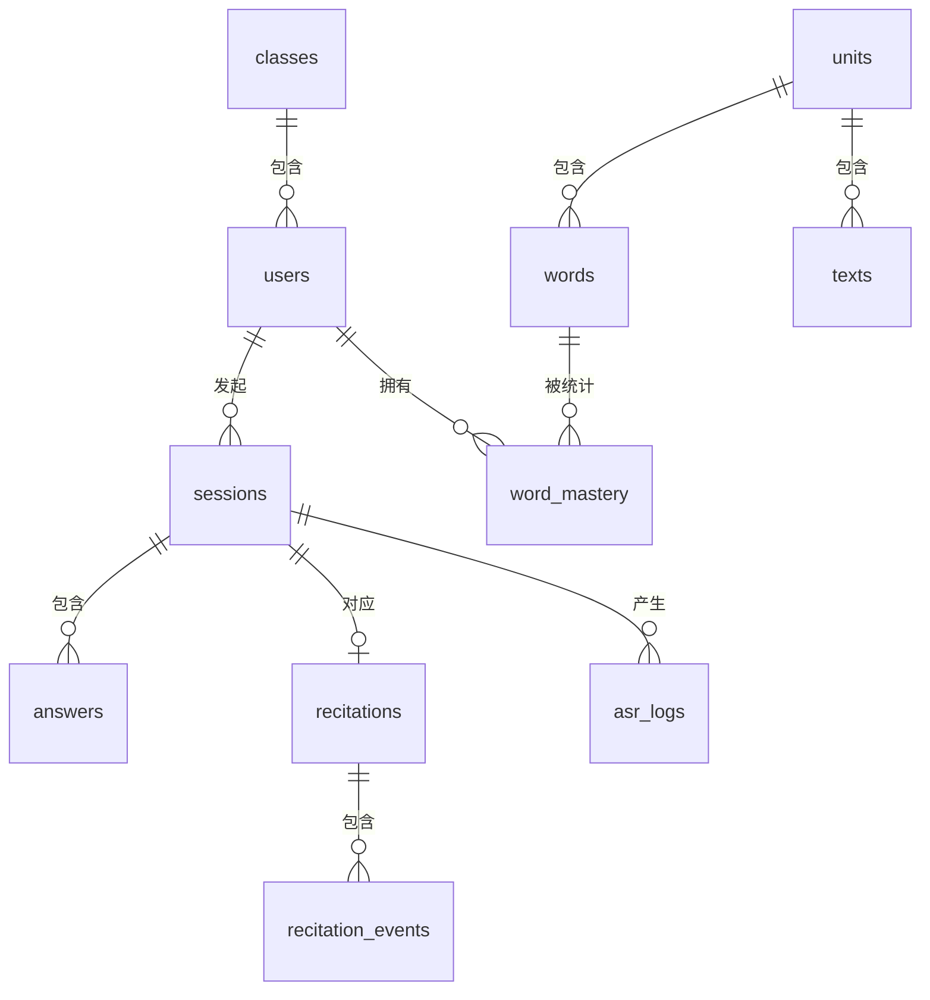

# 背记系统 数据库设计

| 项目 | 内容 |
|---|---|
| 文档版本 | v1.0 |
| 编制日期 | 2026-09-23 |
| 关联文档 | 《背记系统需求说明书》v0.2 |
| 数据库 | SQLite 3.38+ |

---

## 1. 设计约定

### 1.1 通用规则

| 事项 | 约定 |
|---|---|
| 主键 | `INTEGER PRIMARY KEY AUTOINCREMENT`，统一命名为 `id` |
| 外键 | 命名 `<单数表名>_id`，全部显式声明 `REFERENCES` 与删除策略 |
| 时间 | 统一用 `TEXT` 存 ISO 8601 UTC 字符串：`YYYY-MM-DDTHH:MM:SSZ` |
| 布尔 | 用 `INTEGER` 存 `0` / `1`，字段名不加 `is_` 前缀时也在注释中说明 |
| JSON | 用 `TEXT` 存 JSON 字符串，配合 SQLite JSON1 扩展查询 |
| 枚举 | 用 `TEXT` + `CHECK` 约束，不使用魔法数字 |
| 金额/评分 | 用 `REAL` |
| 命名 | 表名小写复数，字段名小写下划线 |
| 软删除 | 内容表用 `status` 字段表达（`active` / `inactive`）；有记录的内容不物理删除 |

### 1.2 连接初始化（每次建立连接必须执行）

```sql
PRAGMA foreign_keys = ON;
PRAGMA journal_mode = WAL;
PRAGMA busy_timeout = 5000;
PRAGMA synchronous = NORMAL;
```

### 1.3 外键删除策略对照

| 场景 | 策略 | 理由 |
|---|---|---|
| 单元删除 → 词条 / 课文 | `CASCADE` | 单元是内容的容器，删容器即删内容（仅在无记录时允许） |
| 学生删除 → 场次 / 答题 | `CASCADE` | 账号删除即数据删除 |
| 词条 / 课文删除 → 答题记录 | `SET NULL` | 记录不能因内容被删而消失，靠 `expected` 快照字段兜底 |
| 班级删除 → 用户 | `SET NULL` | 学生不因班级解散而消失，转为「未分班」 |
| 场次删除 → ASR 日志 | `SET NULL` | 日志独立留存用于成本统计 |

---

## 2. 实体关系



---

## 3. 表结构定义

### 3.1 classes — 班级

```sql
CREATE TABLE classes (
    id          INTEGER PRIMARY KEY AUTOINCREMENT,
    name        TEXT    NOT NULL,
    grade       INTEGER NOT NULL CHECK (grade BETWEEN 1 AND 9),
    semester    TEXT    NOT NULL CHECK (semester IN ('first', 'second')),
    school_year TEXT,
    remark      TEXT,
    status      TEXT    NOT NULL DEFAULT 'active'
                        CHECK (status IN ('active', 'archived')),
    created_at  TEXT    NOT NULL DEFAULT (strftime('%Y-%m-%dT%H:%M:%SZ', 'now')),
    updated_at  TEXT
);

CREATE UNIQUE INDEX uk_classes_name ON classes(name) WHERE status = 'active';
```

| 字段 | 说明 |
|---|---|
| `semester` | `first` = 上学期，`second` = 下学期 |
| `school_year` | 学年标识，如 `2026-2027`，可选 |
| `status` | `archived` 表示已归档班级，不再出现在默认列表 |

### 3.2 users — 用户

```sql
CREATE TABLE users (
    id                 INTEGER PRIMARY KEY AUTOINCREMENT,
    role               TEXT    NOT NULL CHECK (role IN ('admin', 'student')),
    username           TEXT    NOT NULL COLLATE NOCASE,
    real_name          TEXT    NOT NULL,
    password_hash      TEXT    NOT NULL,
    class_id           INTEGER REFERENCES classes(id) ON DELETE SET NULL,
    register_source    TEXT    NOT NULL DEFAULT 'import'
                               CHECK (register_source IN ('import', 'self')),
    preferred_grade    INTEGER CHECK (preferred_grade IS NULL
                                      OR preferred_grade BETWEEN 1 AND 9),
    preferred_semester TEXT    CHECK (preferred_semester IS NULL
                                      OR preferred_semester IN ('first', 'second')),
    last_login_at      TEXT,
    status             TEXT    NOT NULL DEFAULT 'active'
                               CHECK (status IN ('active', 'disabled')),
    created_at         TEXT    NOT NULL DEFAULT (strftime('%Y-%m-%dT%H:%M:%SZ', 'now')),
    updated_at         TEXT
);

CREATE UNIQUE INDEX uk_users_username ON users(username);
CREATE INDEX idx_users_class       ON users(class_id, role, status);
CREATE INDEX idx_users_reg_source  ON users(register_source, status);
```

| 字段 | 说明 |
|---|---|
| `username` | 学号或用户名，`NOCASE` 保证大小写不重复 |
| `class_id` | 可空 = 「未分班」，管理者可后台归班 |
| `register_source` | `import` = 管理者导入，`self` = 学生自主注册 |
| `preferred_grade` / `preferred_semester` | 年级学期偏好记忆，换设备可同步 |
| `password_hash` | bcrypt，禁止任何形式的明文或可逆加密 |

### 3.3 units — 单元

```sql
CREATE TABLE units (
    id         INTEGER PRIMARY KEY AUTOINCREMENT,
    subject    TEXT    NOT NULL CHECK (subject IN ('chinese', 'english')),
    grade      INTEGER NOT NULL CHECK (grade BETWEEN 1 AND 9),
    semester   TEXT    NOT NULL CHECK (semester IN ('first', 'second')),
    name       TEXT    NOT NULL,
    order_no   INTEGER NOT NULL DEFAULT 0,
    remark     TEXT,
    status     TEXT    NOT NULL DEFAULT 'active'
                       CHECK (status IN ('active', 'inactive')),
    created_at TEXT    NOT NULL DEFAULT (strftime('%Y-%m-%dT%H:%M:%SZ', 'now')),
    updated_at TEXT
);

CREATE UNIQUE INDEX uk_units       ON units(subject, grade, semester, name);
CREATE INDEX idx_units_lookup      ON units(subject, grade, semester, status, order_no);
```

### 3.4 words — 英语词条

```sql
CREATE TABLE words (
    id            INTEGER PRIMARY KEY AUTOINCREMENT,
    unit_id       INTEGER NOT NULL REFERENCES units(id) ON DELETE CASCADE,
    type          TEXT    NOT NULL CHECK (type IN ('word', 'phrase', 'sentence')),
    en            TEXT    NOT NULL,
    cn            TEXT    NOT NULL,
    accepted      TEXT,
    phonetic      TEXT,
    pos           TEXT,
    example_en    TEXT,
    example_cn    TEXT,
    require_spell INTEGER NOT NULL DEFAULT 1 CHECK (require_spell IN (0, 1)),
    order_no      INTEGER NOT NULL DEFAULT 0,
    status        TEXT    NOT NULL DEFAULT 'active'
                          CHECK (status IN ('active', 'inactive')),
    created_at    TEXT    NOT NULL DEFAULT (strftime('%Y-%m-%dT%H:%M:%SZ', 'now')),
    updated_at    TEXT
);

CREATE UNIQUE INDEX uk_words       ON words(unit_id, en);
CREATE INDEX idx_words_pick        ON words(unit_id, status, order_no);
CREATE INDEX idx_words_type        ON words(unit_id, type, status);
```

| 字段 | 说明 |
|---|---|
| `accepted` | JSON 数组字符串，如 `["课室","教室"]`；命中任意一个判对 |
| `require_spell` | 是否需要拼读环节。建议：`word` 类型 = 1，`phrase` / `sentence` = 0 |
| `status` | `inactive` = 停用，不参与出题，历史记录保留 |

### 3.5 texts — 语文课文

```sql
CREATE TABLE texts (
    id             INTEGER PRIMARY KEY AUTOINCREMENT,
    unit_id        INTEGER NOT NULL REFERENCES units(id) ON DELETE CASCADE,
    title          TEXT    NOT NULL,
    author         TEXT,
    content_raw    TEXT    NOT NULL,
    content_plain  TEXT    NOT NULL,
    content_pinyin TEXT    NOT NULL,
    paragraphs     TEXT    NOT NULL,
    recite_scope   TEXT    NOT NULL,
    total_chars    INTEGER NOT NULL DEFAULT 0,
    order_no       INTEGER NOT NULL DEFAULT 0,
    status         TEXT    NOT NULL DEFAULT 'active'
                           CHECK (status IN ('active', 'inactive')),
    created_at     TEXT    NOT NULL DEFAULT (strftime('%Y-%m-%dT%H:%M:%SZ', 'now')),
    updated_at     TEXT
);

CREATE UNIQUE INDEX uk_texts       ON texts(unit_id, title);
CREATE INDEX idx_texts_pick        ON texts(unit_id, status, order_no);
```

| 字段 | 说明 |
|---|---|
| `content_raw` | 原始正文，保留标点与换行，用于展示 |
| `content_plain` | **纯字序列**（去除标点、空白），对齐算法的基准 |
| `content_pinyin` | 与 `content_plain` **等长**的无声调拼音序列，空格分隔。对齐在拼音层进行，避免同音字误判 |
| `paragraphs` | JSON：`[{"idx":0,"text":"我与父亲…","chars":12,"recite":true}, …]` |
| `recite_scope` | JSON：背诵段落的索引数组，如 `[0,1,2]` |
| `total_chars` | 背诵范围内的总字数，冗余存储避免每次计算 |

**关键约束**：`content_plain` 与 `content_pinyin` 必须**严格等长**（按空格切分后数组长度一致）。导入时校验，不一致直接拒绝入库。这是对齐算法正确性的前提。

### 3.6 sessions — 练习场次

```sql
CREATE TABLE sessions (
    id            INTEGER PRIMARY KEY AUTOINCREMENT,
    student_id    INTEGER NOT NULL REFERENCES users(id) ON DELETE CASCADE,
    unit_id       INTEGER REFERENCES units(id) ON DELETE SET NULL,
    content_type  TEXT    NOT NULL CHECK (content_type IN ('english', 'chinese')),
    strategy      TEXT    NOT NULL,
    total_items   INTEGER NOT NULL DEFAULT 0,
    correct_items INTEGER NOT NULL DEFAULT 0,
    hint_count    INTEGER NOT NULL DEFAULT 0,
    time_limit_ms INTEGER NOT NULL DEFAULT 0,
    score         REAL,
    status        TEXT    NOT NULL DEFAULT 'ongoing'
                          CHECK (status IN ('ongoing', 'finished', 'abandoned')),
    started_at    TEXT    NOT NULL DEFAULT (strftime('%Y-%m-%dT%H:%M:%SZ', 'now')),
    ended_at      TEXT
);

CREATE INDEX idx_sessions_student ON sessions(student_id, started_at DESC);
CREATE INDEX idx_sessions_unit    ON sessions(unit_id, content_type, started_at DESC);
CREATE INDEX idx_sessions_status  ON sessions(status, started_at DESC);
```

| 字段 | 说明 |
|---|---|
| `strategy` | **出题策略快照** JSON，记录当时的范围/数量/顺序/模式/限时。策略以后改了也不影响历史统计口径 |
| `time_limit_ms` | 0 表示不限时 |
| `status` | `abandoned` = 中途放弃（学生退出未结算） |

`strategy` JSON 结构示例：

```json
{
  "scope": "unit",
  "scope_detail": null,
  "count": 20,
  "count_mode": "random",
  "order": "sequential",
  "mode": "cn2en",
  "time_limit_ms": 0
}
```

### 3.7 answers — 英语答题明细

```sql
CREATE TABLE answers (
    id              INTEGER PRIMARY KEY AUTOINCREMENT,
    session_id      INTEGER NOT NULL REFERENCES sessions(id) ON DELETE CASCADE,
    student_id      INTEGER NOT NULL REFERENCES users(id) ON DELETE CASCADE,
    word_id         INTEGER REFERENCES words(id) ON DELETE SET NULL,
    mode            TEXT    NOT NULL CHECK (mode IN ('cn2en', 'en2cn')),
    step            INTEGER NOT NULL DEFAULT 1 CHECK (step IN (1, 2)),
    expected        TEXT    NOT NULL,
    asr_text        TEXT,
    letter_seq      TEXT,
    target_seq      TEXT,
    answer_text     TEXT,
    is_correct      INTEGER NOT NULL DEFAULT 0 CHECK (is_correct IN (0, 1)),
    match_type      TEXT    NOT NULL DEFAULT 'wrong'
                            CHECK (match_type IN ('exact', 'loose', 'fuzzy',
                                                  'wrong', 'timeout', 'empty')),
    asr_confidence  REAL,
    duration_ms     INTEGER NOT NULL DEFAULT 0,
    first_voice_ms  INTEGER,
    retry_count     INTEGER NOT NULL DEFAULT 0,
    used_keyboard   INTEGER NOT NULL DEFAULT 0 CHECK (used_keyboard IN (0, 1)),
    hint_level      INTEGER NOT NULL DEFAULT 0 CHECK (hint_level BETWEEN 0 AND 3),
    used_hint_count INTEGER NOT NULL DEFAULT 0,
    appealed        INTEGER NOT NULL DEFAULT 0 CHECK (appealed IN (0, 1)),
    appeal_result   TEXT CHECK (appeal_result IS NULL
                                OR appeal_result IN ('upheld', 'rejected')),
    provider        TEXT,
    created_at      TEXT    NOT NULL DEFAULT (strftime('%Y-%m-%dT%H:%M:%SZ', 'now'))
);

CREATE INDEX idx_answers_session      ON answers(session_id, id);
CREATE INDEX idx_answers_stu_word     ON answers(student_id, word_id, created_at DESC);
CREATE INDEX idx_answers_appeal       ON answers(appealed, appeal_result, created_at DESC);
CREATE INDEX idx_answers_stu_created  ON answers(student_id, created_at DESC);
```

| 字段 | 说明 |
|---|---|
| `step` | 1 = 说单词，2 = 拼字母 |
| `expected` | **标准答案快照**。词条被改或删除后，历史记录仍能还原当时的答案 |
| `letter_seq` | 拼读步骤归一化后的字母序列，如 `class` |
| `target_seq` | 拼读步骤的目标字母序列，回显差异时做对齐用 |
| `match_type` | `empty` = 识别为空（不计错，单独统计） |
| `appeal_result` | `upheld` = 申诉成立，`rejected` = 驳回 |
| `provider` | 本次识别的厂商，用于质量问题归因 |

> 每条 `word` 的完整答题会产生 **2 条** `answers` 记录（说词 + 拼读），通过 `step` 区分。

### 3.8 recitations — 语文背诵记录

```sql
CREATE TABLE recitations (
    id             INTEGER PRIMARY KEY AUTOINCREMENT,
    session_id     INTEGER NOT NULL REFERENCES sessions(id) ON DELETE CASCADE,
    student_id     INTEGER NOT NULL REFERENCES users(id) ON DELETE CASCADE,
    text_id        INTEGER REFERENCES texts(id) ON DELETE SET NULL,
    scope_snapshot TEXT,
    transcript     TEXT,
    total_chars    INTEGER NOT NULL DEFAULT 0,
    matched_chars  INTEGER NOT NULL DEFAULT 0,
    missed_chars   TEXT,
    hint_count     TEXT,
    restart_count  INTEGER NOT NULL DEFAULT 0,
    duration_ms    INTEGER NOT NULL DEFAULT 0,
    first_voice_ms INTEGER,
    covered_ratio  REAL    NOT NULL DEFAULT 0,
    score          REAL,
    grade          TEXT,
    finish_reason  TEXT    CHECK (finish_reason IN ('completed', 'manual', 'timeout')),
    created_at     TEXT    NOT NULL DEFAULT (strftime('%Y-%m-%dT%H:%M:%SZ', 'now'))
);

CREATE INDEX idx_recitations_student ON recitations(student_id, created_at DESC);
CREATE INDEX idx_recitations_text    ON recitations(text_id, created_at DESC);
```

| 字段 | 说明 |
|---|---|
| `scope_snapshot` | JSON，本次背诵范围的字符索引区间 |
| `transcript` | 完整识别文本 |
| `missed_chars` | JSON 数组，漏字位置 `[5, 6, 12]` |
| `hint_count` | JSON 对象，分档统计 `{"1":2,"2":1,"3":0}` |
| `finish_reason` | `completed` 背完 / `manual` 手动结束 / `timeout` 超时 |

### 3.9 recitation_events — 背诵事件流

```sql
CREATE TABLE recitation_events (
    id            INTEGER PRIMARY KEY AUTOINCREMENT,
    recitation_id INTEGER NOT NULL REFERENCES recitations(id) ON DELETE CASCADE,
    seq           INTEGER NOT NULL,
    pos           INTEGER NOT NULL,
    char          TEXT,
    event_type    TEXT    NOT NULL
                          CHECK (event_type IN ('matched', 'missed', 'hint',
                                                'restart', 'noise')),
    hint_level    INTEGER,
    trigger_by    TEXT    CHECK (trigger_by IS NULL
                                 OR trigger_by IN ('manual', 'auto')),
    elapsed_ms    INTEGER,
    created_at    TEXT    NOT NULL DEFAULT (strftime('%Y-%m-%dT%H:%M:%SZ', 'now'))
);

CREATE INDEX idx_recitation_events ON recitation_events(recitation_id, seq);
```

用途：驱动「结算页回看」——按时间轴还原学生背到哪个字卡住了、在哪里用了提示。一期只写不读，二期做回放。

**写入策略**：事件量大（一篇课文可能上百条），采用**批量写入**，在背诵结束时一次性提交，避免流式过程中频繁写库。

### 3.10 word_mastery — 词条掌握度（物化表）

```sql
CREATE TABLE word_mastery (
    student_id      INTEGER NOT NULL REFERENCES users(id) ON DELETE CASCADE,
    word_id         INTEGER NOT NULL REFERENCES words(id) ON DELETE CASCADE,
    streak          INTEGER NOT NULL DEFAULT 0,
    total_count     INTEGER NOT NULL DEFAULT 0,
    correct_count   INTEGER NOT NULL DEFAULT 0,
    wrong_count     INTEGER NOT NULL DEFAULT 0,
    hint_total      INTEGER NOT NULL DEFAULT 0,
    last_result     INTEGER CHECK (last_result IS NULL OR last_result IN (0, 1)),
    last_answer_at  TEXT,
    mastered_at     TEXT,
    avg_duration_ms INTEGER NOT NULL DEFAULT 0,
    PRIMARY KEY (student_id, word_id)
);

CREATE INDEX idx_mastery_student  ON word_mastery(student_id, mastered_at);
CREATE INDEX idx_mastery_wrong    ON word_mastery(student_id, wrong_count DESC);
```

**为什么要有这张表**：学生端首页要展示每个词条的掌握状态（未练 / 有错 / 全对 / 已掌握），如果每次都去 `answers` 表实时聚合，随着记录增长会越来越慢。这张表在每次答题后增量更新，首页查询 O(1)。

**更新时机**：`answers` 写入成功后，在同一事务内更新对应 `(student_id, word_id)` 的统计。

### 3.11 asr_logs — 语音调用日志

```sql
CREATE TABLE asr_logs (
    id         INTEGER PRIMARY KEY AUTOINCREMENT,
    session_id INTEGER REFERENCES sessions(id) ON DELETE SET NULL,
    student_id INTEGER REFERENCES users(id) ON DELETE SET NULL,
    provider   TEXT    NOT NULL,
    model      TEXT,
    lang       TEXT,
    task_type  TEXT,
    audio_ms   INTEGER NOT NULL DEFAULT 0,
    latency_ms INTEGER,
    status     TEXT    NOT NULL CHECK (status IN ('ok', 'empty', 'timeout', 'error')),
    error_code TEXT,
    created_at TEXT    NOT NULL DEFAULT (strftime('%Y-%m-%dT%H:%M:%SZ', 'now'))
);

CREATE INDEX idx_asr_logs_time ON asr_logs(created_at DESC);
CREATE INDEX idx_asr_logs_stat ON asr_logs(provider, status, created_at DESC);
```

保留策略：明细保留 90 天，更早的数据按天聚合后删除明细（聚合结果入 `asr_daily_stats`）。

### 3.12 asr_daily_stats — 语音用量日汇总

```sql
CREATE TABLE asr_daily_stats (
    stat_date     TEXT    NOT NULL,
    provider      TEXT    NOT NULL,
    call_count    INTEGER NOT NULL DEFAULT 0,
    total_audio_ms INTEGER NOT NULL DEFAULT 0,
    avg_latency_ms INTEGER,
    ok_count      INTEGER NOT NULL DEFAULT 0,
    empty_count   INTEGER NOT NULL DEFAULT 0,
    error_count   INTEGER NOT NULL DEFAULT 0,
    PRIMARY KEY (stat_date, provider)
);
```

### 3.13 settings — 系统配置

```sql
CREATE TABLE settings (
    key         TEXT PRIMARY KEY,
    value       TEXT NOT NULL,
    value_type  TEXT NOT NULL DEFAULT 'string'
                     CHECK (value_type IN ('string', 'int', 'bool', 'json')),
    description TEXT,
    updated_at  TEXT
);
```

### 3.14 audit_logs — 管理端操作日志

```sql
CREATE TABLE audit_logs (
    id          INTEGER PRIMARY KEY AUTOINCREMENT,
    user_id     INTEGER REFERENCES users(id) ON DELETE SET NULL,
    action      TEXT    NOT NULL,
    target_type TEXT,
    target_id   INTEGER,
    detail      TEXT,
    ip          TEXT,
    created_at  TEXT    NOT NULL DEFAULT (strftime('%Y-%m-%dT%H:%M:%SZ', 'now'))
);

CREATE INDEX idx_audit_time ON audit_logs(created_at DESC);
CREATE INDEX idx_audit_user ON audit_logs(user_id, created_at DESC);
```

### 3.15 schema_version — 版本管理

```sql
CREATE TABLE schema_version (
    version    INTEGER PRIMARY KEY,
    applied_at TEXT NOT NULL DEFAULT (strftime('%Y-%m-%dT%H:%M:%SZ', 'now')),
    description TEXT
);
```

所有 DDL 变更通过**编号迁移脚本**执行（`001_init.sql`、`002_add_xxx.sql`），启动时检查版本号并自动升级。禁止手工改数据库结构。

---

## 4. 初始数据

```sql
INSERT INTO settings (key, value, value_type, description) VALUES
('time_limit_behavior',    'A',    'string', '限时到点行为：A自动判错 / B跳过 / C继续但标记'),
('retry_score_penalty',    '10',   'int',    '每次重试扣分'),
('keyboard_score_penalty', '15',   'int',    '使用键盘输入扣分'),
('hint_score_l1',          '20',   'int',    '一档提示扣分'),
('hint_score_l2',          '40',   'int',    '二档提示扣分'),
('hint_score_l3',          '60',   'int',    '三档提示扣分'),
('silence_hint_ms',        '8000', 'int',    '连续静音自动提示阈值（毫秒）'),
('miss_streak_hint',       '5',    'int',    '连续漏字触发提示的阈值'),
('mastery_streak',         '3',    'int',    '连续答对多少次数算「已掌握」'),
('recite_weight_cover',    '0.6',  'string', '背诵评分：覆盖比例权重'),
('recite_weight_accuracy', '0.25', 'string', '背诵评分：正确率权重'),
('recite_weight_hint',     '0.15', 'string', '背诵评分：提示惩罚权重'),
('asr_provider',           'aliyun',     'string', '主语音厂商'),
('asr_provider_backup',    'volcengine', 'string', '备用语音厂商（空则不启用）'),
('asr_align_window',       '20',   'int',    '语文对齐滑动窗口大小'),
('asr_noise_threshold',    '0.3',  'string', '识别噪声判定阈值'),
('eye_rest_minutes',       '20',   'int',    '护眼休息提醒间隔（分钟）'),
('eye_rest_enabled',       '1',    'bool',   '是否开启护眼休息提醒'),
('eye_warm_mode_auto',     '1',    'bool',   '是否按时间段自动切换暖色模式'),
('page_size_default',      '20',   'int',    '列表默认分页大小');
```

---

## 5. 统计视图

### 5.1 v_word_error_ranking — 错题榜

```sql
CREATE VIEW v_word_error_ranking AS
SELECT
    w.id            AS word_id,
    w.en,
    w.cn,
    w.unit_id,
    COUNT(*)                                         AS error_count,
    COUNT(DISTINCT a.student_id)                     AS student_count,
    MAX(a.created_at)                                AS last_error_at
FROM answers a
JOIN words w ON w.id = a.word_id
WHERE a.is_correct = 0
  AND a.match_type <> 'empty'
GROUP BY w.id, w.en, w.cn, w.unit_id;
```

### 5.2 v_student_unit_progress — 学生单元进度

```sql
CREATE VIEW v_student_unit_progress AS
SELECT
    m.student_id,
    w.unit_id,
    COUNT(*)                                        AS word_total,
    SUM(CASE WHEN m.total_count > 0 THEN 1 ELSE 0 END) AS word_practiced,
    SUM(CASE WHEN m.mastered_at IS NOT NULL THEN 1 ELSE 0 END) AS word_mastered,
    SUM(m.correct_count)                            AS correct_total,
    SUM(m.total_count)                              AS answer_total
FROM word_mastery m
JOIN words w ON w.id = m.word_id
GROUP BY m.student_id, w.unit_id;
```

### 5.3 v_class_today_activity — 班级今日活动

```sql
CREATE VIEW v_class_today_activity AS
SELECT
    u.class_id,
    DATE(s.started_at)                              AS stat_date,
    COUNT(DISTINCT s.student_id)                    AS active_students,
    COUNT(s.id)                                     AS session_count,
    SUM(s.total_items)                              AS item_total,
    SUM(s.correct_items)                            AS item_correct
FROM sessions s
JOIN users u ON u.id = s.student_id
WHERE s.status = 'finished'
GROUP BY u.class_id, DATE(s.started_at);
```

---

## 6. 容量与性能估算

| 表 | 单条记录量级 | 日增量（40 人） | 年增量 |
|---|---|---|---|
| `answers` | ~300 B | ~3200 条 | ~115 万条 |
| `recitations` | ~2 KB | ~40 条 | ~1.4 万条 |
| `recitation_events` | ~100 B | ~4000 条 | ~140 万条 |
| `word_mastery` | ~100 B | 增量更新 | 固定 ~ 学生数 × 词条数 |
| `asr_logs` | ~120 B | ~1600 条 | ~58 万条 |

- 一年后数据库约 **600 MB ~ 1 GB**，SQLite 完全可承受。
- `answers` 表需要重点关注的索引：`idx_answers_stu_word`（错题本）、`idx_answers_stu_created`（个人记录分页）。
- 每年新学年前做一次归档：把两年前的 `answers` / `recitation_events` 导出为归档库，主库只保留近两年，控制单库体积。

---

## 7. 备份与恢复

### 7.1 备份（每日 02:00）

```bash
sqlite3 /path/to/app.db "VACUUM INTO '/backup/app_$(date +%Y%m%d).db'"
```

**不要直接复制 `.db` 文件**——WAL 模式下主文件可能不含最新事务，会得到不一致的备份。

### 7.2 恢复

```bash
systemctl stop bjsys        # 或停止 Windows 服务
cp /backup/app_20260923.db /path/to/app.db
rm -f /path/to/app.db-wal /path/to/app.db-shm
systemctl start bjsys
```

### 7.3 校验

备份完成后自动执行 `PRAGMA integrity_check`，结果写入 `audit_logs`，失败则告警。
