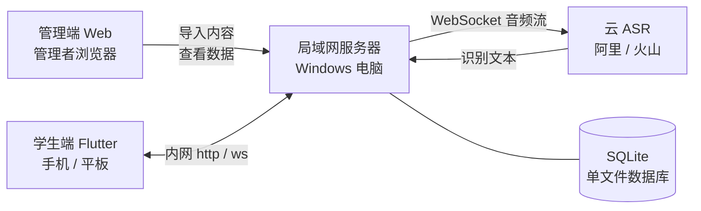
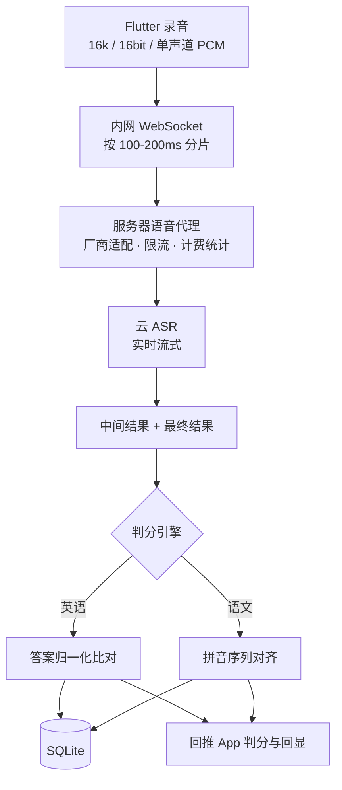
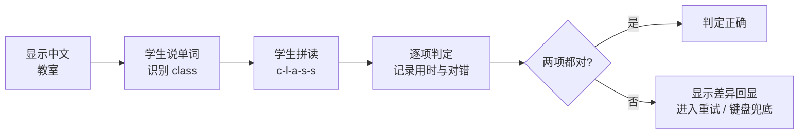
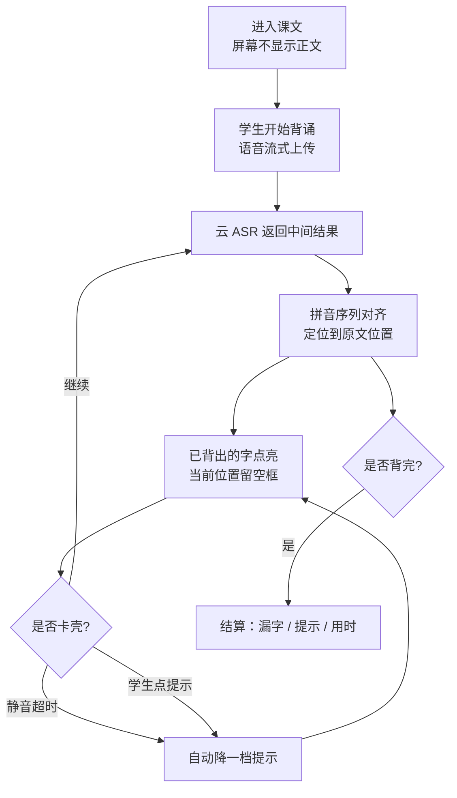
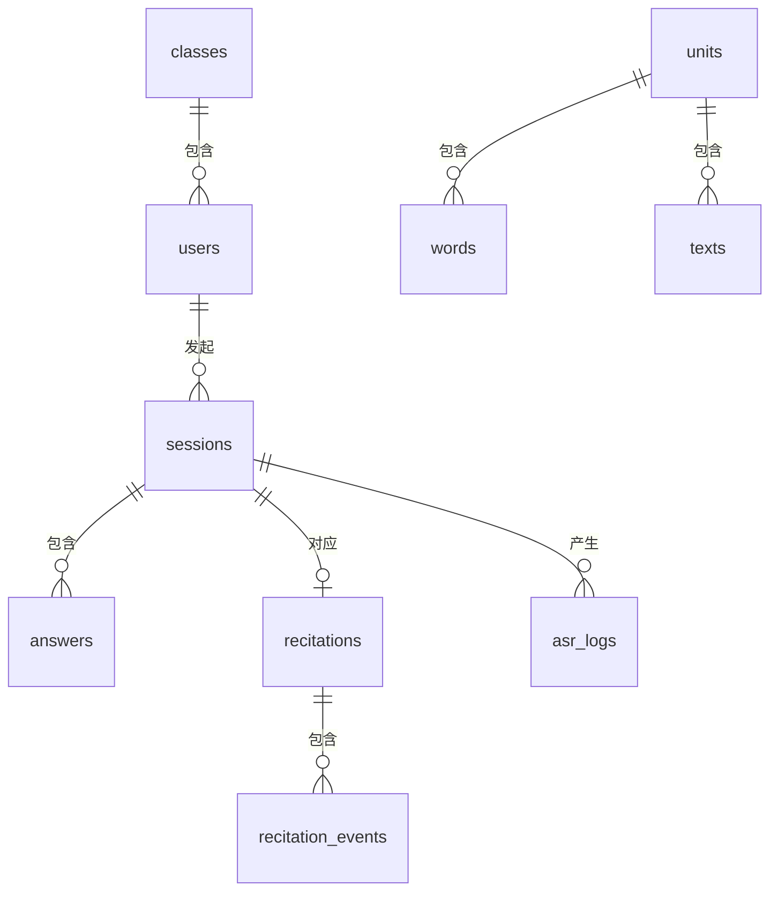
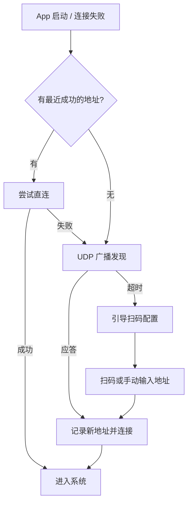

# 背记系统 需求说明书

| 项目 | 内容 |
|---|---|
| 文档版本 | v0.6（模型选型已定稿） |
| 编制日期 | 2026-09-23 |
| 状态 | 待评审 |
| 适用范围 | 一期开发 |
| 系统代号 | 暂定，待命名 |

> 本文档把前期需求碰撞中确定的所有决策固化为可执行的规格。文中标注 **[待确认]** 的条目需要评审时拍板，其余视为已确定。

## 修订记录

| 版本 | 日期 | 变更内容 |
|---|---|---|
| v0.1 | 2026-09-23 | 初稿 |
| v0.2 | 2026-09-23 | 依据评审意见修订 16 项：适用范围扩至中小学；内容支持修改/停用/删除；新增出题策略；新增学生自主注册；新增练习配置与进度可视化；年级学期选择本地记忆；数据库改用 SQLite；语音厂商双配置并保留多模态兜底；导入模板增加年级/学期/学科列；新增部署与网络配置章节（IP 发现）；拼读增加逐字母回显；语文显示粒度定为按字；角色术语统一为管理者/学生 |
| v0.3 | 2026-09-23 | 详细设计拆分出三份独立文档：《数据库设计》《接口设计》《UI 设计规范》。本章 §7 §8 调整为概览性质并指向详细文档 |
| v0.4 | 2026-09-23 | 依据第二轮评审 4 项决议修订：① 服务端口统一为 `8810`；② 掌握状态枚举收敛为唯一口径（词条级/单元级共用）；③ 新增「学生提交申诉」「错题本」两个接口，并入《接口设计》§8.8/§8.9；④ 明确**语音优先原则**（键盘仅作降级兜底，不得主动引导），多模态仲裁改为按预研结论决定是否一期启用，新增 §9.8「语音识别预研」章节 |
| v0.5 | 2026-09-23 | **第一批 ASR 预研执行完毕**（报告 `qa/ASR预研报告.md`），5 处设计变更回写：① **拼读语种由 `en` 改为 `zh`**（实测 85%→95%，旧结论「中文模型识别英文会翻车」作废）；② **定制热词作废**（实测无效）；③ 切分引导改为**逐字母**形式，禁用音节切分（实测全灭）；④ **多模态仲裁改为「一期启用」**（实测与 ASR 互补）；⑤ 谐音表扩容优先级 `R` > `B/P` > `W/V` > 元音。同步修订 §5.4 §6.2 §8.3 §9.1 §9.2 §9.3 §9.7 §9.8 §12 §13 |
| v0.6 | 2026-09-23 | **第二批（模型选型）执行完毕**（报告 `qa/ASR模型选型报告.md`），4 处修订：① **模型改为按场景双配置** —— 语文 `qwen-audio-3.1-asr-flash-streaming`（首字 340–354ms）、英语 `fun-asr-flash-2026-06-15`（负样本 4/4 忠实）；② **`qwen3-asr-flash` 列入禁用清单** —— 它会把学生错读「脑补」成正确词（`GLASS`→`CLASS`），判分场景下属教学事故；③ 新增选型维度「**忠实度**」并在 §9.3 增加约束条目；④ 谐音表新增最高优先级混淆对 **`C/G`**。同步修订 §9.1 §9.2 §9.3 §9.8 |

## 配套文档

本文档描述「做什么」，以下文档描述「怎么做」：

| 文档 | 内容 |
|---|---|
| 《背记系统数据库设计》 | 完整 SQLite DDL、索引、视图、备份策略 |
| 《背记系统接口设计》 | 统一响应规范、错误码、全部接口定义、WebSocket 协议、服务发现协议 |
| 《背记系统 UI 设计规范》 | 三套护眼主题、分龄字号与触控标准、页面设计、组件规范、无障碍 |

---

## 1. 项目概述

### 1.1 背景与目标

面向**中小学**（小学 1–6 年级、初中 7–9 年级）语文、英语的背诵练习场景，建设一套「局域网内网部署」的辅助学习系统。系统解决三个问题：

1. **内容怎么进去**：管理者把教材内容按年级 / 学期 / 单元批量导入，不用逐条手工录入，导入后可随时修改、停用、删除。
2. **孩子怎么练**：学生在安卓设备上完成英语单词（短语、句子）和语文课文的背诵，系统负责出题、听音、判分。练什么、怎么练由学生自由选择。
3. **练得怎么样**：所有答题过程留痕，学生端实时可见掌握情况，管理者可查看全班数据，并为后续的重复练习算法（SRS）提供数据基础。

### 1.2 使用对象与规模

- **管理者**：1～3 人（任课教师或教务），通过 Web 管理端操作。
- **学生**：一个班，几十人（按 40 人设计，留 60 人余量）。**支持学生自主注册，注册即可使用，无需审核。**
- **部署位置**：一台局域网内的 Windows 电脑，同时充当应用服务器和数据库服务器。
- **网络条件**：该电脑**可以访问外网**（用于调用云端语音识别）。
- **使用场景**：课后家庭作业为主，课上统一练习为辅。

### 1.3 术语定义

| 术语 | 含义 |
|---|---|
| 管理者 | 系统的后台操作者，负责内容与班级管理、数据查看。本文档统一使用此称谓，不使用「老师」 |
| 学生 | 系统的学习者，使用安卓端 |
| 单元 | 内容组织的最小单位，隶属「学科 + 年级 + 学期」 |
| 词条 | 英语内容的基本单位，类型为单词 / 短语 / 句子 |
| 课文 | 语文内容的基本单位，含标题、作者、正文、背诵范围 |
| 背诵范围 | 课文中要求背诵的段落集合，未标记的段落不参与背诵 |
| 题次 | 一次答题行为，对应一条 `answers` 记录 |
| 背诵场次 | 一次完整的课文背诵过程，对应一条 `recitations` 记录 |
| 出题策略 | 一次练习的范围、数量、顺序、模式与限时的组合 |
| 提示 | 学生卡壳时系统放水的行为，分三档 |
| 对齐 | 把学生的语音识别结果映射到课文原文位置的过程 |

---

## 2. 系统总体设计

### 2.1 系统架构



关键约束：

- **App 不直连云 ASR**。所有音频经局域网服务器中转，AccessKey 只保存在服务器端，避免 APK 反编译后密钥泄露导致盗刷。
- **服务器可访问外网**，云 ASR 调用无障碍；同时按 §9.4 设计降级策略，防止外网抖动影响使用。
- **服务地址由 App 自动发现**，详见 §10。服务器 IP 变更不应导致学生端失联。

### 2.2 技术选型

| 层级 | 选型 | 说明 |
|---|---|---|
| 学生端 | Flutter 3.x | 一套代码同时出手机与平板；录音用 `record` 或 `flutter_sound` |
| 管理端 | Web（Vue 3 或 React） | 浏览器访问，无需安装 |
| 后端 | FastAPI + uvicorn | 与现有技术栈一致 |
| 数据库 | **SQLite 3.38+** | 单文件、零运维；开启 WAL 模式 |
| 语音识别 | 阿里云 / 火山引擎实时流式 ASR | **两个厂商配置都保留**，配置文件切换 |
| 部署 | Windows + 固定内网 IP（建议路由器绑定）+ 每日自动备份 | |

**SQLite 使用约束**

| 事项 | 要求 |
|---|---|
| 日志模式 | 必须开启 `PRAGMA journal_mode=WAL` |
| 外键 | 必须开启 `PRAGMA foreign_keys=ON` |
| 写锁等待 | 设置 `busy_timeout=5000`，避免并发写直接报错 |
| 连接管理 | 写操作串行化（单写连接或写队列），读操作可并发 |
| 时间字段 | 统一用 TEXT 存 ISO 8601 UTC 字符串（如 `2026-09-23T10:11:29Z`） |
| 布尔字段 | 用 INTEGER 存 0 / 1 |
| JSON 字段 | 用 TEXT 存 JSON 字符串，借助 JSON1 扩展查询 |
| 备份方式 | 使用 `VACUUM INTO` 或 `.backup` 命令，**不要直接复制 .db 文件**（WAL 模式下可能不一致） |

> 并发评估：40 名学生同时答题时，写操作频率约每人每 3–10 秒一条，峰值写入 QPS 个位数，WAL 模式下 SQLite 完全可承载。

### 2.3 数据流



---

## 3. 角色与权限

系统**只有两个角色**：管理者、学生。

| 角色 | 入口 | 权限 |
|---|---|---|
| 管理者 | 管理端 Web | 班级管理、学生管理、内容导入与编辑（含停用 / 删除）、查看全班数据、系统配置 |
| 学生 | 学生端 App | 自主注册登录、自由选择练习内容与方式、完成背诵、查看自己的进度与记录 |

- 一期**不设家长角色**。
- 管理者账号由系统初始化时创建，不开放自助注册。
- 学生账号支持两种来源：① 管理者批量导入；② 学生自主注册（注册即可用，无需审核）。
- **[待确认]** 是否需要「仅可录入内容、不可查看数据」的二级管理者账号。一期默认不需要。

### 3.1 学生账号的两种来源与合并规则

| 来源 | 说明 |
|---|---|
| 管理者导入 | Excel 批量导入 `学号 + 姓名`，系统生成初始弱口令 |
| 学生自主注册 | 学生在 App 填写 `学号 / 用户名 + 姓名 + 密码`，可选填班级 |

**绑定与冲突规则**

1. 学号（或用户名）在全校范围内唯一，作为账号主键。
2. 学生自主注册时，若该学号**已存在**（管理者已导入），提示「该学号已存在，请直接登录或联系管理者重置密码」，**不覆盖已有账号**。
3. 学生注册时**不选班级**也允许（进入「未分班」状态），管理者可在后台一键归班。
4. 学生注册时可选班级（下拉列表），选择后立即生效。
5. **[待确认]** 是否允许学生自主注册时修改姓名。建议允许填写、由管理者后台可纠正。

---

## 4. 内容管理端需求（Web）

### 4.1 登录

- 账号为自定义用户名，密码加盐哈希存储（bcrypt）。
- 登录成功签发 JWT，有效期 12 小时，支持记住登录。
- 连续 5 次密码错误锁定 10 分钟。

### 4.2 班级与学生管理

- 创建班级：填写班级名称、年级、学期。
- **批量导入学生**：Excel 模板，必填列 `学号`、`姓名`；可选列 `初始密码`。
  - 学号在本班内唯一，重复导入同一学号时**更新**而非新增。
  - 未填写初始密码时系统生成弱口令（如 `123456`），支持一键导出「学号-初始密码」对照表。
- **学生列表**：支持搜索、按班级筛选、显示注册来源（导入 / 自主注册）。
- **未分班学生**：列表置顶提示，支持勾选后一键归班。
- 支持停用、重置密码、查看单人数据。

### 4.3 内容组织

内容采用三级结构（学科与年级学期共同定位）：

```
学科（语文 / 英语）
  └── 年级（1-9）
        └── 学期（上 / 下）
              └── 单元（可自定义名称与排序）
```

- 单元可自由增删改，支持拖动排序。
- **[待确认]** 是否需要「教材版本」维度（人教版 / 部编版 / 外研版等）。若同一学校只用一套教材，则一期不引入，避免结构复杂化。

### 4.4 Excel 导入：英语词条

**模板列定义**

| 列名 | 必填 | 说明 |
|---|---|---|
| **学科** | 是 | 英语 / 语文（本模板固定为英语） |
| **年级** | 是 | 1–9，下拉选择 |
| **学期** | 是 | 上 / 下，下拉选择 |
| **单元** | 是 | 单元名称，不存在时提示是否自动创建 |
| 类型 | 是 | 单词 / 短语 / 句子 |
| 英文 | 是 | 标准答案 |
| 中文 | 是 | 主要释义 |
| 可接受答案 | 否 | 用 `/` 分隔的其他正确表达，如 `教室/课室` |
| 音标 | 否 | 显示用 |
| 词性 | 否 | 显示用，如 `n.` |
| 例句英文 | 否 | |
| 例句中文 | 否 | |
| 提示 | 否 | 无 |

**关于年级 / 学期 / 学科列（重要）**

导入模板**必须携带这三个字段**，理由：

1. 一份 Excel 可以同时导入多个年级、多个学期的内容，整理教材时不用拆成多个文件反复导入。
2. 文件**自包含**，脱离系统也能看懂内容归属，便于归档和交接。
3. 杜绝「在管理端选错当前上下文，导致内容被导入到错误年级」的事故。
4. 校验更直接：导入时能逐行指出「第 7 行，年级填了 10，超出范围」。

模板中这三个字段使用 **Excel 数据有效性下拉**约束取值范围，从源头减少填错。

**导入规则**

- 一行一个词条；同一「学科 + 年级 + 学期 + 单元 + 英文」重复时以最后一次导入为准。
- 导入分两步：**先校验预览、再确认入库**。预览页展示成功条数、失败条数及原因（缺必填项 / 类型值非法 / 年级越界 / 单元不存在），失败行标红并可下载错误报告。
- **禁止「校验通过即直接入库」**，必须人工点确认。这是防止脏数据进库的关键卡点。

### 4.5 Excel 导入：语文课文

**模板列定义**

| 列名 | 必填 | 说明 |
|---|---|---|
| **学科** | 是 | 本模板固定为语文 |
| **年级** | 是 | 1–9，下拉选择 |
| **学期** | 是 | 上 / 下，下拉选择 |
| **单元** | 是 | |
| 标题 | 是 | |
| 作者 | 否 | |
| 正文 | 是 | 完整正文，段落间用空行或 `\n` 分隔 |
| 背诵段落 | 是 | 段落序号，如 `1-3,5`；填 `全部` 表示整篇背诵 |
| 提示 | 否 | |

**导入规则**

- 正文中的拼音、注释等非背诵内容需在导入时清洗，或允许管理者在预览页手动删除段落。
- 预览页需**按段落展示正文并允许管理者勾选背诵范围**，避免在 Excel 里手工算段落号出错。
- 标点、换行按原文保留，但系统内部另存一份「纯字序列」用于对齐（见 §6.3）。

### 4.6 内容编辑、停用与删除

| 操作 | 行为 | 约束 |
|---|---|---|
| **修改** | 在线编辑词条 / 课文，保存后立即生效 | 已有答题记录不受影响，统计以记录内的快照字段为准 |
| **停用** | 状态置为「停用」，不再参与出题，学生端不可见 | 历史记录完整保留，仍计入统计 |
| **删除** | 从库中移除 | **仅当该内容无任何关联答题记录时允许**；已有记录时「删除」按钮置灰，提示「该内容已有 N 条练习记录，为保证统计完整只能停用」 |

**设计理由**：如果允许删除已有记录的内容，历史统计会凭空出现缺口（例如「本月单元错误率」的分子分母对不上），这类数据不一致后期极难排查。因此用「停用」承接绝大部分需求，删除只留给刚导入就发现错误的场景。

- 支持批量操作：批量停用、批量启用。
- 停用 / 删除均记录操作人与时间。
- **[待确认]** 内容被停用后，学生端已安排的练习如何处理。建议：直接从待练列表移除，已生成的场次记录保留。

### 4.7 数据看板

| 视图 | 内容 |
|---|---|
| 班级概览 | 今日完成率、平均正确率、平均用时、活跃人数 |
| 单元掌握度 | 按单元统计平均正确率、完成人数、未完成名单 |
| 词条错题榜 | 错误次数 Top N 的词条，附错误人数 |
| 学生个人报告 | 正确率趋势、错题清单、课文背诵评级、提示次数统计 |
| 申诉复核 | 被标记为 `fuzzy` / `loose` 及学生申诉的题次列表 |
| 导出 | 上述视图均支持导出 Excel |

### 4.8 服务地址与二维码

- 管理端首页显著位置显示**当前服务地址**（如 `http://192.168.1.80:8810`）与**配置二维码**。
- 二维码内容为服务地址的编码串（如 `bjsys://192.168.1.80:8810`），供学生端扫码配置。
- 服务器启动时自动探测本机所有可用网卡地址，多网卡时下拉切换。
- IP 发生变化时，管理端首页给出提示，并自动刷新二维码。

---

## 5. 学生端需求（Flutter）

### 5.1 注册与登录

**注册（注册即可用，无需审核）**

- 填写项：学号 / 用户名（必填）、姓名（必填）、密码（必填，允许 6 位纯数字弱口令）、班级（可选，下拉选择）。
- 学号已存在时提示「该学号已存在，请直接登录」。
- 注册成功直接进入系统，**无审核流程**。

**登录**

- 学号 + 密码，登录成功后本地保存 Token，下次启动免登录。
- 提供「切换账号」入口，便于设备共用。
- 忘记密码：提示联系管理者重置（不做自助找回）。

### 5.2 首页与学习进度

**年级学期记忆（重要）**

- 首次进入时引导学生选择 **年级 + 学期**。
- 选择后**本地持久化**，后续进入系统不再询问，直接使用该设置。
- 首页顶部常驻显示当前「年级 · 学期」，点击可随时切换。
- **[待确认]** 是否在学生账号上也记录该偏好（用于换设备时同步）。建议记录，但本地优先。

**进度可视化**

首页按「单元 → 课 / 词条组」逐级展示，每个条目带**状态标记**，让学生一眼看到自己练到哪、练得怎么样：

| 状态 | 标记 | 触发条件 |
|---|---|---|
| 未练 | 灰色空心 | 从未练习 |
| 练过 · 有错 | 错误标记 | 练习过且存在错误题次 |
| 练过 · 全对 | 正确标记 | 练习过且全部正确 |
| 已掌握 | 星标 | 连续答对 3 次（见 §6.5） |

- 单元卡片显示：词条总数、已练数量、正确率、上次练习时间。
- 课文卡片显示：是否背过、最近一次评级、最长连续正确段落数。
- 支持在首页直接进入「只练错题」。

### 5.3 练习配置（学习形式自选）

学生可以完全自由地决定练什么、怎么练。点击单元后进入**练习配置页**，提供五个维度的选择：

**① 范围**

| 选项 | 说明 |
|---|---|
| 整个单元 | 默认 |
| 指定课 / 指定课文 | 语文按课文选 |
| 指定段落 | 语文按段落选 |
| 自定义区间 | 词条序号区间，如第 5–20 个 |
| 只练错题 | 从错题本中筛出本单元内容 |
| 只练未掌握 | 排除已掌握的词条 |

**② 数量**

| 选项 | 说明 |
|---|---|
| 全部 | 默认 |
| 前 N 个 | 按顺序取前 N 个 |
| 随机 N 个 | 从范围内随机抽 N 个 |

**③ 顺序**

| 选项 | 说明 |
|---|---|
| **顺序出题** | **默认**，按 `order_no` 依次出 |
| 随机出题 | 打乱顺序 |
| 错题优先 | 错题排在前面，其余顺序出 |
| 倒序出题 | 从后往前 |

**④ 模式（英语专有）**

| 选项 | 说明 |
|---|---|
| 中文 → 英文（说词 + 拼读） | |
| 英文 → 中文 | |
| 混合 | 两种模式随机交替出现 |

**⑤ 限时**

| 选项 | 说明 |
|---|---|
| 不限时 | **默认** |
| 单题限时 | 15 / 30 / 60 秒 |
| 整组限时 | 5 / 10 / 15 分钟 |

**交互要求**

- 各维度用**卡片式选择**呈现，不用下拉框，降低操作门槛。
- 提供**「开始练习」快捷入口**：在单元页直接点开始，即按默认组合（全部 + 顺序 + 不限时 + 中文→英文）开练，不需要每次配置。
- 配置页顶部实时显示本次练习的题量与预计用时。
- **[待确认]** 是否需要「保存我的练习方案」以便复用。建议一期不做，二期再加。

### 5.4 英语模式一：中文 → 英文（语音 + 拼读）

**流程**



**详细规则**

1. **出题**：屏幕显示中文释义。若词条配置了例句，第二屏可显示例句（可关闭）。
2. **第一步：说单词**
   - 学生对着麦克风说出英文单词，引擎按 `language=en` 识别（**整词识别必须用 `en`**，见 §9.2）。
   - 识别结果**实时回显**，判定规则见 §6.1。
3. **第二步：拼读字母**
   - 屏幕按**固定切分提示**显示引导，如 `c｜l｜a｜s｜s`；短语和句子按单词分组。
   - **切分引导必须是「逐字母」形式**（`c｜l｜a｜s｜s`），**严禁使用音节切分**（`cla-ss`、`pen-cil`）。
     > 实测依据（见 `qa/ASR预研报告.md` §3.1）：音节切分是**非词字母组合**，ASR 无法识别，
     > 22 条测试样本**无一正确**，引擎会强行归到最近的自然语言词上（`cla ss` → `Alex.`，`li ttle` → 中文乱码）。
   - 学生逐个念字母；也接受连读形式（`c-l-a-s-s`、`class`）。
   - 判定规则见 §6.2，**逐字母回显要求见下**。
4. **重试（语音优先）**：任一步骤失败后允许重试，单步骤最多重试 **2 次**；**第 3 次失败才自动弹出键盘输入**，前 2 次只提示「没听清，再说一次」，**不引导键盘**。
5. **键盘兜底（降级路径，非主路径）**：屏幕**常驻**「改用键盘」入口但**视觉弱化**，学生可随时切换手动输入；**默认不主动引导**。原则详见 §6.2。
6. **记录**：两次判定结果、各自用时、重试次数、键盘使用、提示使用，全部落库。

**逐字母回显（学生必须知道自己错在哪一位）**

判定完成后，屏幕以**逐位对齐**的方式展示差异，而不是只给一个「对 / 错」：

```
正确拼读   c   l   a   s   s
你的拼读   c   l   e   s   s
                   ▲
             第 3 位听成 e，应为 a
```

回显规则：

| 情况 | 表现 |
|---|---|
| 该位正确 | 正常显示，标记为正确 |
| 该位读错 | 显示学生实际念出的字母，并用醒目标记标出差异位 |
| 该位缺失 | 用占位符标出「这里没听到」 |
| 多念了字母 | 额外显示多出的字母，标记为多余 |

- 对齐算法：先做字母序列的编辑距离对齐并回溯得到对齐路径，再逐位渲染。
- 回显同时展示**学生原始识别文本**（如「see ell aye ess ess」），便于学生理解机器听到了什么，也便于管理者排查识别问题。
- 若判定结果为「识别为空」，回显提示「没听清，请靠近麦克风再说一次」，**不计错**。

**界面要求**

- 当前正在听音时必须有明显的录音动效（波形或呼吸圆）。
- 判定反馈延迟超过 1 秒要有 loading 状态。
- 差异回显要停留足够时间（建议不自动消失，由学生点「继续」翻页）。

### 5.5 英语模式二：英文 → 中文

- 屏幕显示英文单词 / 短语 / 句子。
- 学生说出中文意思，引擎按 `language=zh` 识别。
- 若词条配置了「可接受答案」，命中任意一个即判对。
- 判定规则见 §6.1；识别结果同样**实时回显**。
- 该模式**不要求拼读**。

### 5.6 语文背诵模式：逐字点亮

**流程**



**显示规则**

| 区域 | 表现 |
|---|---|
| 已背出的字 | 正常显示（高亮） |
| 当前位置 | 空框标记，表明「这里还有字」 |
| 未背到的字 | **完全不显示**，仅保留占位空间 |
| 标点 | 不显示，不影响对齐 |

**显示粒度：按字。** 已确定，不做按词切换。（「父亲」会拆成「父」「亲」两个字分别点亮。）

**其他要求**

- 提供「重新开始本段」「暂停」按钮。
- 背诵过程中若识别连续失败，需给明确提示（如「没听清，请靠近麦克风再说一次」），不能静默卡死。
- 结束后展示结算页：总字数、已背字数、漏字数、错字数、提示次数、总用时、首次发声延迟、评级。
- 结算页支持「回看」：以列表形式标出漏掉和背错的字及其位置。

### 5.7 提示机制

**三档提示**

| 档位 | 放水内容 |
|---|---|
| 一档 | 只显示出后面还有几个字（一排空框） |
| 二档 | 显示下一个字的首字（中文给首字，英文给首字母） |
| 三档 | 直接显示下一个字 / 下一个单词的完整答案 |

**触发方式（双通道）**

1. 主动：学生点击「我卡住了」按钮，每次点击降一档。
2. 自动：检测到连续静音超过 **8 秒**（可配置），自动降一档提示；同一位置不重复触发。

**记录**

- 每次提示记录档位、位置、触发方式（主动 / 自动）。
- 提示次数是掌握度的核心指标，**必须落库**。

### 5.8 计时规则

| 模式 | 默认 | 可设置 |
|---|---|---|
| 英语 | 不限时 | 单题限时 15 / 30 / 60 秒，或整组限时 5 / 10 / 15 分钟 |
| 语文 | 不限时 | 整篇限时 3 / 5 / 10 分钟 |

**计时起点**

- 英语：题目文字**完全渲染完成**的那一刻开始计时。
- 语文：学生点击「开始背诵」后开始计时。

**同时记录两个时长**

- `duration_ms`：题目出现到判定完成的总用时（用于展示与统计）。
- `first_voice_ms`：题目出现到学生第一次发声的延迟（用于分析「是不会还是反应慢」）。

**限时到点行为**（管理者可配置，默认 A）

| 选项 | 行为 |
|---|---|
| A（默认） | 自动判错，进入下一题 |
| B | 自动跳过，不计入对错，记「超时未答」 |
| C | 继续答题，但结果永久标记「超时」 |

- 语文到点行为：停止录音，按已背出比例结算。

### 5.9 错题本与我

- 错题本：按单元列出答错过的词条，显示错误次数、最近一次错误时间，支持「只练错题」直接开练。
- 我的记录：按日期列出练习场次与成绩，可查看单次详情。
- 我的统计：正确率趋势、已掌握词条数、连续练习天数。
- **[待确认]** 是否需要游戏化激励（星星、连续打卡、排行榜）。建议二期再评估，避免低龄学生分心。

---

## 6. 关键规则定义

> 本章是整个系统的判分核心，开发前必须逐条确认，避免后期反复调整口径。

### 6.1 文本答案判定（英语说词、英译中）

判定按顺序执行，命中即停：

| 顺序 | 规则 | 结果 |
|---|---|---|
| 1 | 完全一致（归一化后） | 正确 |
| 2 | 属于该词条的「可接受答案」之一 | 正确（记为 `exact`） |
| 3 | 学生答案**包含**某个可接受答案，且长度不超过其 2 倍 | 正确，标记 `loose`（宽松命中） |
| 4 | 相似度 ≥ 0.85 且目标长度 ≥ 5 | 记为 `fuzzy`，**允许申诉** |
| 5 | 其余 | 错误 |

**归一化处理**（判定前统一执行）

- 转小写、去首尾空格、多个连续空格合一。
- 去除英文标点（撇号保留，如 `don't`）。
- 中文去除标点与空格。
- 数字统一转阿拉伯数字。

**同音词处理**：不做自动等同。`there` 与 `their` 视为不同答案，只有词条显式配置了「可接受答案」才算正确。理由：同音词正是英语学习的重点，不能放过。

**申诉机制**：`fuzzy` 与 `loose` 结果给「我读对了」按钮，申诉后该题次标记 `appealed=true`，**不改变对错**，但进入管理者的待复核列表，同时作为识别质量数据留存。

### 6.2 拼读判定（英语拼字母）

**归一化步骤**

1. 取云 ASR 返回文本。
2. 按**谐音映射表**把识别结果转为字母：`see / sea / 西` → `c`，`ell / 艾尔 / 艾勒` → `l`，`double u` → `w` 等，覆盖 A–Z 含中文谐音。
3. 去除所有非字母字符（空格、连字符、点号）。
4. 得到纯字母序列。

**判定**

| 顺序 | 规则 | 结果 |
|---|---|---|
| 1 | 字母序列与目标完全一致 | 正确 |
| 2 | 目标长度 ≥ 6 且仅 1 处差异 | 记为 `fuzzy`，允许申诉 |
| 3 | 其余 | 错误 |

**说明**

- 该规则天然支持多种念法：`c-l-a-s-s`、`c l a s s`、`class` 归一化后均为 `class`。
- **音节切分（`cla-ss`）不在支持范围内**。实测 ASR 对非词字母组合无法识别（见 `qa/ASR预研报告.md` §3.1），屏幕引导也**不得**让学生按音节念。
- **谐音映射表按实测结果扩容**，优先级：`R` > `B/P` > `W/V` > 元音。依据见 `qa/ASR预研报告.md` §3.2。
- **语音优先原则（硬约束）**：拼读以**语音为主要交互**，键盘**只是降级兜底，不是并列选项**。键盘入口常驻但视觉弱化；一旦使用键盘，按 `keyboard_score_penalty` 扣分并单独统计（`answers.used_keyboard`）。
- **降级触发条件**（满足其一才切键盘）：连续 3 次识别为空或失败；或云端返回 `50001` / `50002`。**不得因单次失败就引导孩子改用键盘。**
- **降级必须留痕**：`used_keyboard` 单独统计，管理端「键盘使用率」是评估语音链路效果的核心指标，也是决定多模态是否提前上线的依据（见 §9.8）。
- 无论是语音还是键盘输入，**都必须做逐字母差异回显**（见 §5.4）。
- **无论判定结果如何，都必须做逐字母差异回显**（见 §5.4），让学生知道错在哪一位。

### 6.3 语文对齐规则

**预处理**

1. 从课文中提取背诵范围内的纯字序列 `chars[]`，同时保留「字 → 段落 / 位置」的映射。
2. 每个字转无声调拼音，得到 `pinyin[]`。**对齐在拼音层进行**，这样「的 / 地 / 得」「在 / 再」等同音字不会误判为错误。

**流式对齐**

- 维护指针 `pos`，初始为 0。
- 每次收到云 ASR 的中间结果，取增量文本，与 `pinyin[pos : pos+N]` 做局部最优对齐（编辑距离 / 最长公共子序列，窗口 `N = 20`）。
- 匹配成功：`pos` 前移，对应字数累计为「已背出」。
- 匹配失败：若单次增量与窗口的匹配率低于阈值（建议 0.3），**判定为识别噪声，忽略该段**，不推进也不计错。

**容错策略**

| 情况 | 处理 |
|---|---|
| 同音字 | 拼音相同即判对 |
| 漏字 | 允许跳过，`pos` 越过该字并记入「漏字」清单 |
| 连续漏字 ≥ 5 个 | 判定卡壳，触发自动提示 |
| 回读重复（重复已背内容） | 不回退 `pos`，仅记录 |
| 多字（学生加了字） | 忽略多余内容，不判错 |
| 完全背错一段 | 匹配率低于阈值时视为噪声，等待学生自我纠正 |

**结束条件**

- `pos` 到达末尾 → 正常完成。
- 学生点「结束背诵」→ 按已覆盖比例结算，未背部分计入漏字。
- 超时 → 同「结束背诵」。

**结算指标**：总字数、已背字数、漏字数、覆盖比例、提示次数（分档统计）、总用时、首次发声延迟。

### 6.4 评定规则（建议值，管理者可配置）

**英语单题**

| 情况 | 结果 |
|---|---|
| 两步均一次通过，无提示 | 满分 |
| 使用过重试 | 每重试 1 次扣 10 分 |
| 使用键盘输入 | 扣 15 分 |
| 使用提示 | 一档扣 20 分，二档扣 40 分，三档扣 60 分 |
| 最终答错 | 0 分 |

**语文背诵**

| 指标 | 权重 |
|---|---|
| 覆盖比例 | 60% |
| 正确率（1 − 漏字数 / 总字数） | 25% |
| 提示惩罚 | 15%（每次提示扣 5 分，扣完为止） |

评级：90 分以上「优秀」，75–89「良好」，60–74「合格」，60 以下「待加强」。

**[待确认]** 上述分值与权重均为建议值，需结合实际教学口径调整。

### 6.5 掌握度模型（为二期 SRS 预留）

一期只做记录与展示，算法留到二期。但数据必须现在存全，否则后期无法回算。

**词条掌握度建议规则**

- 连续答对 3 次 → 标记「已掌握」（首页星标）。
- 答错 → 星级清零，进入错题本。
- 平均用时与提示次数作为熟练度参考。

**必须落库的字段**（缺一不可）

- 每次答题的原始识别文本、判定结果、匹配类型（`exact` / `loose` / `fuzzy` / `wrong`）
- 用时、首次发声延迟、重试次数、键盘使用、提示档位与次数
- 使用的模式（中→英 / 英→中）
- 识别置信度（若厂商返回）
- 是否申诉

---

## 7. 数据模型（概览）

> **完整 DDL、索引、视图与备份策略见《背记系统数据库设计》v1.0。** 本章只保留结构概览与语义说明，字段以详细设计文档为准。



**表清单**

| 表名 | 说明 |
|---|---|
| `classes` | 班级 |
| `users` | 用户（管理者 / 学生），含 `role`、`class_id`、`register_source` |
| `units` | 单元，含 `subject`、`grade`、`semester`、`order_no`、`status` |
| `words` | 英语词条，含 `status`（启用 / 停用） |
| `texts` | 语文课文，含 `status` |
| `sessions` | 一次练习场次，含出题策略快照 |
| `answers` | 英语答题明细（题次级） |
| `recitations` | 语文背诵场次记录 |
| `recitation_events` | 背诵过程中的事件流（点亮 / 漏字 / 提示），用于回放，一期可只写不读 |
| `asr_logs` | 语音调用日志，用于成本统计与质量分析 |
| `settings` | 系统配置（限时行为、提示扣分、静音阈值等） |

**关键字段说明（SQLite 类型）**

`users`

| 字段 | 类型 | 说明 |
|---|---|---|
| id | INTEGER PK AUTOINCREMENT | |
| role | TEXT | admin / student |
| username | TEXT UNIQUE | 学号或用户名 |
| real_name | TEXT | 姓名 |
| password_hash | TEXT | bcrypt |
| class_id | INTEGER FK | 可空（未分班） |
| register_source | TEXT | import / self |
| preferred_grade | INTEGER | 记忆的年级偏好 |
| preferred_semester | TEXT | 记忆的学期偏好 |
| status | TEXT | active / disabled |
| created_at | TEXT | ISO 8601 UTC |

`units`

| 字段 | 类型 | 说明 |
|---|---|---|
| id | INTEGER PK | |
| subject | TEXT | chinese / english |
| grade | INTEGER | 1–9 |
| semester | TEXT | first / second |
| name | TEXT | 单元名称 |
| order_no | INTEGER | 排序 |
| status | TEXT | active / inactive |

`words`

| 字段 | 类型 | 说明 |
|---|---|---|
| id | INTEGER PK | |
| unit_id | INTEGER FK | |
| type | TEXT | word / phrase / sentence |
| en | TEXT | 标准答案 |
| cn | TEXT | 主要释义 |
| accepted | TEXT | 可接受答案，JSON 数组字符串 |
| phonetic / pos | TEXT | 展示用 |
| example_en / example_cn | TEXT | 例句 |
| order_no | INTEGER | 排序 |
| status | TEXT | active / inactive |

`sessions`

| 字段 | 类型 | 说明 |
|---|---|---|
| id | INTEGER PK | |
| student_id | INTEGER FK | |
| unit_id | INTEGER FK | |
| content_type | TEXT | english / chinese |
| strategy | TEXT | 出题策略快照（范围/数量/顺序/模式/限时的 JSON） |
| time_limit_ms | INTEGER | 0 表示不限时 |
| started_at / ended_at | TEXT | ISO 8601 UTC |
| total_items / correct_items | INTEGER | |
| hint_count | INTEGER | |
| score | REAL | |

`answers`

| 字段 | 类型 | 说明 |
|---|---|---|
| id | INTEGER PK | |
| session_id | INTEGER FK | |
| student_id | INTEGER FK | |
| word_id | INTEGER FK | |
| mode | TEXT | cn2en / en2cn |
| step | INTEGER | 1=说词，2=拼读 |
| expected | TEXT | 标准答案快照 |
| asr_text | TEXT | 识别原文 |
| answer_text | TEXT | 最终采纳答案（键盘输入时为输入值） |
| is_correct | INTEGER | 0 / 1 |
| match_type | TEXT | exact / loose / fuzzy / wrong / timeout |
| asr_confidence | REAL | 可空 |
| duration_ms | INTEGER | 总用时 |
| first_voice_ms | INTEGER | 首次发声延迟 |
| retry_count | INTEGER | |
| used_keyboard | INTEGER | |
| hint_level | INTEGER | 0=未用提示 |
| used_hint_count | INTEGER | |
| appealed | INTEGER | |
| created_at | TEXT | |

`recitations`

| 字段 | 类型 | 说明 |
|---|---|---|
| id | INTEGER PK | |
| session_id | INTEGER FK | |
| student_id / text_id | INTEGER FK | |
| transcript | TEXT | 完整识别文本 |
| total_chars | INTEGER | 范围内总字数 |
| matched_chars | INTEGER | 已背出字数 |
| missed_chars | TEXT | 漏字位置，JSON 数组 |
| hint_count | TEXT | 分档提示次数，JSON，如 `{"1":2,"2":1,"3":0}` |
| duration_ms | INTEGER | |
| first_voice_ms | INTEGER | |
| covered_ratio | REAL | 覆盖比例 |
| score | REAL | 综合得分 |
| grade | TEXT | 评级 |
| created_at | TEXT | |

> 完整 DDL 在《数据库设计》文档中给出，本文档只定义结构与语义。

---

## 8. 接口清单（概览）

> **完整接口定义、请求/响应示例、错误码表与 WebSocket 协议见《背记系统接口设计》v1.0。** 本章只保留接口总览，便于快速定位。

### 8.1 管理端

| 方法 | 路径 | 说明 |
|---|---|---|
| POST | `/api/auth/login` | 登录 |
| GET | `/api/classes` | 班级列表 |
| POST | `/api/classes` | 创建班级 |
| POST | `/api/classes/{id}/students/import` | 导入学生名单 |
| GET | `/api/classes/{id}/students` | 学生列表 |
| POST | `/api/students/{id}/assign-class` | 归班（含未分班批量归班） |
| POST | `/api/students/{id}/reset-password` | 重置密码 |
| GET | `/api/units` | 单元列表（按 subject / grade / semester 过滤） |
| POST | `/api/units` | 新建单元 |
| POST | `/api/import/words/preview` | 英语词条导入校验预览 |
| POST | `/api/import/words/commit` | 英语词条确认入库 |
| POST | `/api/import/texts/preview` | 课文导入校验预览 |
| POST | `/api/import/texts/commit` | 课文确认入库 |
| PATCH | `/api/words/{id}` | 修改词条 |
| POST | `/api/words/batch-status` | 批量启用 / 停用 |
| DELETE | `/api/words/{id}` | 删除词条（无记录时才允许） |
| GET | `/api/stats/class/{id}` | 班级概览 |
| GET | `/api/stats/unit/{id}` | 单元掌握度 |
| GET | `/api/stats/word/ranking` | 错题榜 |
| GET | `/api/stats/student/{id}` | 学生个人报告 |
| GET | `/api/appeals` | 待复核申诉列表 |
| GET | `/api/server/info` | 当前服务地址、可用网卡列表、二维码内容 |

### 8.2 学生端

| 方法 | 路径 | 说明 |
|---|---|---|
| POST | `/api/auth/register` | 学生自主注册 |
| POST | `/api/auth/login` | 登录 |
| GET | `/api/me/profile` | 个人信息与年级学期偏好 |
| PUT | `/api/me/profile` | 更新年级学期偏好 |
| GET | `/api/me/units` | 我的单元列表与进度 |
| GET | `/api/units/{id}/words` | 拉取单元词条 |
| GET | `/api/units/{id}/texts` | 拉取单元课文 |
| POST | `/api/sessions` | 开始一次练习（携带出题策略） |
| POST | `/api/sessions/{id}/answers` | 提交一次答题结果 |
| POST | `/api/sessions/{id}/finish` | 结束练习，返回结算 |
| POST | `/api/recitations/{id}/settle` | 提交背诵结算结果 |
| GET | `/api/me/wrong-words` | 错题本 |
| GET | `/api/me/records` | 我的记录 |
| GET | `/api/me/progress` | 进度统计（各单元状态汇总） |
| **WS** | `/ws/asr` | 音频流上行 + 识别结果下行（核心通道） |

### 8.3 WebSocket 协议（`/ws/asr`）

**上行（客户端 → 服务器）**

| 消息 | 内容 |
|---|---|
| `start` | `{session_id, task_type, lang: "en"\|"zh", hotwords: [...]}` |
| `audio` | 二进制 PCM 分片（16k / 16bit / 单声道，每片 100–200ms） |
| `end` | 结束本次识别 |

**下行（服务器 → 客户端）**

| 消息 | 内容 |
|---|---|
| `partial` | 中间识别结果（用于语文逐字点亮） |
| `final` | 最终识别结果 |
| `verdict` | 判定结果（含 `match_type`、是否需要差异回显） |
| `error` | 错误码与提示（含降级指令） |

**热词传递**：接口层保留 `hotwords` 字段（契约 §6.4），但**一期服务端不启用**。

> **[2026-09-23 预研结论]** 实测 `qwen3-asr-flash` 对两种热词参数（`asr_options.vocabulary`、`asr_options.context`）
> **均无任何改善**——3 条失败样本 × 2 种写法，无一被救回（见 `qa/ASR预研报告.md` §4.2）。
> 原计划"把 A–Z 谐音塞进热词、在引擎层解决字母识别"的思路**作废**，谐音映射表必须落在服务端自己这一层（BE-04）。
> 换厂商或换模型时需重新验证热词是否有效。

### 8.4 服务发现接口

| 方式 | 说明 |
|---|---|
| UDP 广播 | 服务器监听 UDP 端口（如 9527），响应 App 的探测包，返回 `{host, port, name}` |
| HTTP | `GET /api/ping` 返回服务名与版本，供 App 探活 |

---

## 9. 语音技术方案

### 9.1 厂商选择：双配置并存

**阿里云和火山引擎的接入配置都保留**，通过服务端配置文件切换，代码走统一的适配器接口。

**[2026-09-23 选型实测定稿]** 按场景选定**双模型**，依据 `qa/ASR模型选型报告.md`：

| 场景 | 选定模型 | 类型 | 关键指标 |
|---|---|---|---|
| **语文背诵（逐字点亮）** | **`qwen-audio-3.1-asr-flash-streaming`** | WebSocket 流式 | 首字 **340–354ms**；中文 2/2 全对；中间包 8–10 个 |
| **英语说词 / 拼读** | **`fun-asr-flash-2026-06-15`** | HTTP 非流式 | **负样本 4/4 忠实**；P50 323ms；带逐词时间戳 |
| 拼读交叉校验（可选） | `qwen-audio-3.0-asr-flash` | HTTP 非流式 | 与上面结论不一致时二次判定 |

**⛔ 禁用模型：`qwen3-asr-flash`。** 它会把学生的**错读"脑补"成正确单词**——实测中学生念
`G L A S S`（错）它返回 `CLASS`、念 `A B P L E` 返回 `APPLE`，判分场景下等于**放过错读**，
学生会把错的记牢而系统一路给绿灯。这是**教学事故级**的问题，不得用于任何判分环节。

> 关键差异：① **Paraformer / SenseVoice 在本账号下不可用**，原计划的"Paraformer 实时版"作废；
> ② 完整模型 id 对照表、HTTP/WebSocket 调用要点见选型报告 §3；
> ③ **判分模型的选型维度新增一条"忠实度"** —— 准确率高的模型未必能用，
> "听得准"和"猜得准"在判分场景是两回事（详见 §6.2 与选型报告 §2.3）。

**适配器接口设计**（服务端）

```
ASRProvider (抽象基类)
  ├─ start_session(config) -> session
  ├─ push_audio(bytes)
  ├─ on_partial(callback)
  ├─ on_final(callback)
  └─ close()
AliyunProvider(ASRProvider)
VolcengineProvider(ASRProvider)
```

- 配置文件 `asr.yaml` 中指定 `provider: aliyun | volcengine`，并可配置主备（主厂商失败自动切备厂商）。
- **切换厂商不需要改代码、不需要重新发版**，这是保留双配置的核心价值。

**接入注意事项**

- 阿里云：避开老版「智能语音交互」——其语种绑定在**项目模型**上，无法按请求指定，多语种场景会很别扭。
- 火山引擎：豆包大模型流式语音识别**仅对已认证企业用户开放**，无企业主体则无法接入，需先确认资质。因此**阿里云作为主厂商更稳妥**。

### 9.2 语种策略（**已按预研实测修订**）

| 场景 | language | 依据 |
|---|---|---|
| 英语**说单词**（whole） | `en` | 需要用英语语言模型识别单词 |
| 英语**拼字母**（spell） | **`zh`** | 实测 `en` 会把字母串强行拼成单词，见下 |
| 英译中说中文 | `zh` | — |
| 语文背诵 | `zh` | — |

**拼读必须用 `zh`——这是本轮预研最重要的发现。**（详见 `qa/ASR预研报告.md` §4.1）

| 样本 | `en` | `zh` |
|---|---|---|
| `C L A S S` | `Class.` ❌ | `C L A S S。` ✅ |
| `P I G` | `Pig.` ❌ | `p i g。` ✅ |
| `R E S T A U R A N T` | `Restaurante.` ❌ | `r e s t a u r a n t.` ✅ |

干净样本上的准确率：**`en` 85.0% → `zh` 95.0%（+10 个百分点）**。

> **原因**：`en` 会激活英语语言模型，其先验是「这是英语」，于是**主动把字母序列拼合成单词**；
> `zh` 的英语先验很弱，**反而忠实保留字母序列**。
>
> ⚠️ 这与本文档旧版本写的「中文模型识别英文会翻车」**正好相反**，旧结论**已作废**。
> 注意区分：**整词识别仍需 `en`**，只有**逐字母拼读**才改用 `zh`。

> **[2026-09-23 选型实测补充]** 上表的 `en`/`zh` 对照是在 **`qwen3-asr-flash`** 上做的。
> 选型已更换为 `fun-asr-flash-2026-06-15`（见 §9.1），**该模型上的语种效应尚未验证**：
> 它本就倾向输出字母序列（`C L A S S`），可能不需要 `zh` 这个开关，也可能行为不同。
> 实现时 `lang_map.spell` 的取值**以实测为准，不要照搬**。这属于计划内的校准项，不是返工。

### 9.3 准确率优化手段（**已按预研实测修订**）

1. ~~定制热词~~ —— **实测无效，一期不做**（详见 §8.3 与 `qa/ASR预研报告.md` §4.2）。
2. **固定切分引导**：拼读时按**逐字母**方式显示分组（`c｜l｜a｜s｜s`），引导学生按同一节奏念。
   **禁用音节切分**（`cla-ss`）——实测属非词字母组合，ASR 无法识别（22 条样本无一正确）。
3. **谐音映射表扩容**：优先级 **`C/G`** > `R` > `B/P` > `W/V` > 元音。
   （`C/G` 为 2026-09-23 选型实测新增——**全部 6 个候选模型**都出现过 `CLASS`↔`GLASS` 混淆，属共性难题。）
4. **判分模型必须"忠实"**：优先选**不会做语言纠正**的模型。`qwen3-asr-flash` 会把 `GLASS` 纠正成
   `CLASS`，虽提高了"正样本准确率"，却**放过了学生的错读**——判分场景下这是事故，已列入禁用清单（§9.1）。
5. **多模态 / 第二 ASR 仲裁**：ASR 返回空 / 判定 `fuzzy` / 学生申诉时触发（见 §9.7）。
   仲裁后端可配置为多模态（`qwen3.5-omni-plus`）**或另一个 ASR**（`qwen-audio-3.0-asr-flash`，更快更便宜）。
6. **键盘兜底常驻（降级用，视觉弱化）**：见 §5.4 与 §6.2 的语音优先原则。
7. **申诉数据回收**：所有 `fuzzy` / `loose` / 申诉记录进入质量分析，持续迭代谐音映射表。

### 9.4 降级策略

| 故障 | 处理 |
|---|---|
| 云接口超时（> 3 秒无响应） | 提示「网络忙，已切换键盘输入」 |
| 云接口连续失败 3 次 | 整个会话切键盘模式，录音本地暂存 |
| 外网中断 | 全站进入键盘模式，并在管理端告警 |
| 识别结果为空 | 提示「没听清，请再说一次」，不计错 |
| 主厂商故障 | 自动切换备用厂商（若已配置） |

### 9.5 音频规格

- 采样率 16000 Hz，单声道，16 bit，PCM。
- 分片长度 100–200 ms。
- 必须开启**中间结果返回**（阿里：`enable_intermediate_result=true`），否则语文逐字点亮无法实现。

### 9.6 成本控制

- 所有调用经服务器中转，记录 `asr_logs`（调用次数、音频时长、延迟、状态），管理端可查看日 / 周 / 月用量。
- **[待确认]** 按 40 人 × 每天 20 词 × 每词 2 次音频 ≈ 1600 次/天估算总量，需到控制台核算实际费用与是否需要采购资源包。

### 9.7 关于用多模态模型替代 ASR（评审提出）

**结论：多模态不替代专用 ASR 做主链路；但作为「疑难仲裁」，经预研实测后已决定「一期启用」（见本节第 3 条）。**

| 维度 | 专用实时 ASR | 多模态大模型 |
|---|---|---|
| 延迟 | 百毫秒级，支持流式中间结果 | 秒级到数秒，通常整段返回 |
| 逐字时间戳 | 有，可实现逐字点亮 | 一般没有，无法做实时点亮 |
| 短音频高频调用 | 按量计费便宜，适合每天上千次 | 按 token 计费，高频调用成本高 |
| 非自然语音（孤立字母） | 弱项 | 可能更强，能理解上下文语义 |
| 稳定性 | 专门优化，稳定 | 输出格式不固定，需要约束 |

**具体建议**

1. **主链路继续用专用实时 ASR**：语文逐字点亮对延迟和逐字时间戳是硬需求，多模态模型满足不了。
2. **多模态的定位是「疑难仲裁」**：当专用 ASR 返回为空、判定为 `fuzzy`、或学生申诉时，把这段短音频交给多模态模型，提问「这段音频里念的字母序列是什么」，用它的答案做二次判定。调用频率低，成本可控。
3. **是否一期启用：已决定「一期启用」**（2026-09-23 预研结论，见 `qa/ASR预研报告.md` §4.4）。
   实测发现多模态与专用 ASR **互补而非包含**——22 条拼读样本中两者判断不一致 4 条：
   `pig` ASR 更准；`water` / `pencil` / `restaurant` **omni 更准**。
   因此按《预研方案》§6 的决策规则，**一期实现 `ArbitratorProvider`**，作为拼读的第二判据。
   > **产品核心是语音，不能因为识别率不达标就把孩子赶去敲键盘。**
4. **架构现在就要抽象 `ArbitratorProvider`**（与 `ASRProvider` 并列，配置位见契约 §9.2 的 `arbitrator` 段）。即使实现后置，接口与配置先留好，避免到时候改动判分主链路。
5. 验证时用 §9.8 的同一批真实音频做对比，用数据说话。

### 9.8 语音识别预研（**第一批已完成，见 `qa/ASR预研报告.md`**）

> 本产品的核心是语音交互，判分严格度、谐音表规模、是否启用多模态仲裁**全部依赖实测数据**。
> 方案见 `docs/dev/05-ASR预研方案.md`，**第一批执行结果见 `qa/ASR预研报告.md`**。

**第一批（2026-09-23，语种与优化手段验证）**

| 项 | 结果 |
|---|---|
| 可用模型 | `qwen3-asr-flash` / `qwen3-asr-flash-realtime` / `fun-asr-flash`；**Paraformer 全系不可用** |
| 拼读准确率（干净音频） | `en` 85.0% / **`zh` 95.0%** |
| 整词准确率（干净音频） | 85.7% |
| 延迟 | P50 442ms / P95 626ms（非流式） |
| 稳定性 | 同音频 ×3，**100% 一致** |

设计变更：拼读语种 `en` → `zh`；定制热词作废；切分引导改逐字母；多模态仲裁一期启用；谐音表按 `R > B/P > W/V > 元音` 扩容。

**第二批（2026-09-23，模型选型轮次）** —— 详见 `qa/ASR模型选型报告.md`

| 项 | 结果 |
|---|---|
| **选定模型** | 语文 → `qwen-audio-3.1-asr-flash-streaming`；英语 → `fun-asr-flash-2026-06-15` |
| **首字延迟** | **340–354ms**（流式，门限 ≤800ms）✅ |
| 中文课文识别 | 3 个流式模型 **2/2 全对**，中间包 8–10 个 |
| **负样本忠实度** | `fun-asr-flash` / `qwen-audio-3.0`：**4/4 忠实**；`qwen3-asr-flash`：**2/4 掩盖错读** 🔴 |
| 禁用模型 | **`qwen3-asr-flash`**（会把 `GLASS` 脑补成 `CLASS`、`ABPLE` → `APPLE`） |
| 新增混淆对 | **`C/G`** —— 全部 6 个候选模型都出现过，属共性难题 |

设计变更（已回写 §9.1、§9.2、§9.3）：模型改**按场景双配置**；新增「**忠实度**」选型维度与**禁用清单**；`C/G` 加入谐音表最高优先级。

**尚未完成（不可跳过，直接决定上面这些数字能不能当真）**

| # | 待办 | 为什么必须做 |
|---|---|---|
| 1 | **真人录音复测** | 两轮都用 **TTS 合成音**，是**上限**。真人儿童口音预计低 10–25 个百分点 |
| 2 | 验证 `en`/`zh` 结论在真人音频上仍成立 | TTS 可能放大或掩盖该效应 |
| 3 | **在新模型上重验语种效应** | `zh` 的结论是在旧模型 `qwen3-asr-flash` 上测的，**不能照搬**到 `fun-asr-flash` |
| 4 | 扩大负样本至 ≥20 条 | 本轮负样本仅 4 条合格，"掩盖率"目前只有**定性**意义 |
| 5 | 补测噪声环境与麦克风链路 | 两轮全为干净音频，未覆盖教室噪声 |
| 6 | 确认 `qwen-audio-3.1-tts-flash` / `cosyvoice-v3.5-plus` 的接口 | 模型存在但报 `url error`；二期「标准发音示范」依赖 TTS |

> **一句话**：第一批结论支撑了**设计方向**，第二批结论支撑了**模型选型**；
> 但**判分严格度（`fuzzy` 阈值、谐音表规模）依然不能写死**——要等真人录音那一轮。
> 此外，**选型结论本身也建立在 TTS 音频上**：模型的**相对排序**可信（差异极大且机制可解释），
> 但**绝对准确率不可引用**。

---

## 10. 部署与网络配置

> 本章解决「局域网 IP 经常变，学生端连不上」的问题。

### 10.1 问题

局域网内电脑的 IP 由路由器 DHCP 分配，重启路由器、更换网络环境后 IP 可能变化（例如 `192.168.1.80` → `192.168.88.19`）。而学生端必须知道服务器地址才能连接。让学生在 App 里手动改 IP 不现实——**不能要求用户懂网络知识**。

### 10.2 解决方案：三套机制叠加



**① UDP 广播自动发现（首选，零配置）**

- 服务器监听 UDP 端口（如 `9527`）。
- App 在启动或连接失败时，向广播地址 `255.255.255.255:9527` 发送探测包。
- 服务器收到后应答 `{host: "192.168.1.80", port: 8810, name: "背记系统"}`。
- App 记录应答地址并连接，**IP 变了也能自动找回**。
- 限制：需要 App 与服务器处于同一广播域（同一路由器 / 同一 WiFi 下）。跨网段或路由器隔离 AP 时无效，此时走 ② 或 ③。

**② 扫码配置（推荐主路径，用户零门槛）**

- 管理端首页显示一个大二维码，内容为服务地址编码串（如 `bjsys://192.168.1.80:8810`）。
- 学生端提供「扫码配置」入口，扫一下即完成配置。
- 优势：不依赖广播（跨网段也能用）、不需要用户理解 IP 概念、一眼能看懂。
- 这是**最推荐给用户的操作路径**，部署文档中应作为首选手册。

**③ 手动输入（兜底）**

- 提供地址输入框，支持 `192.168.1.80` 或完整 `http://192.168.1.80:8810`。
- 输入后自动探活（`GET /api/ping`），成功才保存。

**④ 地址记忆**

- App 保存**最近一次连接成功的地址**，启动时优先尝试。
- 连接失败不弹报错，直接静默进入发现流程；发现成功则无缝恢复。

### 10.3 治本建议（写进部署手册）

1. **在路由器上把服务器的 MAC 地址与 IP 绑定**（DHCP 静态分配），从根上固定 IP。这是最省事的长期方案。
2. **或者给服务器电脑设置静态 IP。**
3. 服务器启动时自动探测并展示所有可用网卡地址，多网卡场景由管理者选择正确的那个。
4. 管理端首页始终显示当前服务地址与二维码，方便随时重配。
5. **[待确认]** 服务器进程是否需要注册为 Windows 服务，实现开机自启。建议做，避免每次重启后要手动拉起。

---

## 11. 非功能需求

### 11.1 性能

- 单次识别端到端延迟（说话结束到出结果）目标 < 800 ms。
- 支持 40 路并发 WebSocket 音频流；超限时排队并提示。
- 管理端页面首屏 < 2 秒。
- SQLite 在 WAL 模式下支撑 40 人并发读写。

### 11.2 安全

- 密码 bcrypt 加盐哈希，禁止明文存储。
- 接口鉴权使用 JWT，管理端与学生端角色隔离校验。
- **云服务 AccessKey 仅保存在服务器端配置文件**，不得写入 App、不得提交版本库。
- 学生自主注册无审核，属于内网低风险决策；如有异常账号由管理者在后台停用。
- **[待确认]** 内网 http 明文传输，是否需要自签 HTTPS。原生 App 使用 http 录音可行，若未来做 Web 端播放 / 录音才必须上 HTTPS。

### 11.3 隐私

- 学生姓名、成绩属个人信息，仅限内网访问，管理端操作留日志。
- **默认不保存学生录音文件**，音频仅在内存中转发，落库只保留识别文本。理由：节省存储、降低隐私风险。
- 语音数据会传输至第三方云厂商，需在家长告知书中明确说明。

### 11.4 数据备份

- 每日 02:00 自动执行 `VACUUM INTO` 备份，保留最近 30 天。
- 备份文件同时写入**本机以外的介质**（外挂硬盘 / 网盘同步目录）。
- 提供一键恢复脚本，并至少演练一次。
- 理由：所有学生的历史学习数据集中在单机上，硬盘故障即为数据全失。

### 11.5 可用性

- 服务器断电 / 重启后自动拉起服务。
- 学生端在网络中断时不得崩溃，已答数据本地暂存，恢复后补偿上传。

---

## 12. 一期 / 二期范围

### 一期（本次开发）

- **管理端**：管理者登录、班级与学生管理（批量导入 + 未分班归班）、Excel 导入英语词条与语文课文（含年级/学期/学科列）、内容修改/停用/删除、数据看板、错题榜、申诉复核、服务地址与二维码展示
- **学生端**：自主注册与登录、年级学期记忆、学习进度可视化、练习配置（范围/数量/顺序/模式/限时五个维度）、英语两种模式（含拼读与逐字母差异回显、键盘兜底）、语文逐字点亮背诵（按字粒度、含三档提示）、错题本、我的记录
- **语音**：阿里云 + 火山引擎双配置适配器、按题型切语种（**拼读用 `zh`**，见 §9.2）、**多模态仲裁（一期启用）**、五级降级策略
- **网络**：UDP 广播自动发现 + 扫码配置 + 手动输入 + 地址记忆
- **数据**：SQLite（WAL 模式）、全字段落库，为 SRS 预留
- **部署**：局域网 + 每日自动备份 + 开机自启

### 二期（暂不实现，仅预留）

- Word 导入（或一次性转换脚本替代）
- 间隔重复（SRS）复习计划与智能推荐
- 多模态模型兜底判定（§9.7）
- 管理者布置作业与截止提醒
- 课堂实时大屏
- 家长端
- 保存「我的练习方案」
- 离线缓存完整方案
- 内容版本快照

---

## 13. 风险与待确认项

### 13.1 技术风险

| 风险 | 影响 | 应对 |
|---|---|---|
| **云 ASR 对孤立字母识别率不确定** | 拼读环节误判率高，影响体验 | **第一批预研已完成**（`qa/ASR预研报告.md`）：TTS 标准音下拼读 **95%（`zh`）/ 85%（`en`）**。**但真人录音轮次尚未做，真实值预计低 10–25 个百分点——判分阈值在此之前不得写死**。三层缓解：逐字母差异回显 + 多模态仲裁 + 申诉机制 |
| **语种提示用错**（旧结论为「中文模型识别英文会翻车」，实测相反） | 拼读判分下降约 10 个百分点 | 按题型切语种：**整词用 `en`、逐字母拼读用 `zh`**（实测依据见 §9.2） |
| 火山引擎需企业认证 | 备选厂商走不通 | 阿里云作为主厂商，火山作储备 |
| 40 路并发音频流的服务器压力 | 课上统一练习时卡顿 | 提前压测；必要时限制同班并发数 |
| 语文对齐算法效果不达预期 | 逐字点亮错位，功能不可用 | 保留「半自动模式」开关：自动推进失效时切换为「按句手动确认」 |
| 广播发现受网络环境影响 | 部分网络下自动发现失效 | 扫码配置作为主力路径，广播仅作增强 |
| SQLite 写入锁竞争 | 高峰期提交卡顿 | WAL + busy_timeout + 写操作串行化；提前压测 |

### 13.2 待确认项（需评审拍板）

| # | 事项 | 建议 |
|---|---|---|
| 1 | 系统正式名称 | 待定 |
| 2 | 是否需要「教材版本」维度（人教版/部编版等） | 建议一期不做 |
| 3 | 是否需要「只可录入、不可看数据」的二级管理者账号 | 建议一期不做 |
| 4 | 提示扣分与评级的具体分值 | 本文档 §6.4 为建议值，待校准 |
| 5 | 限时到点的默认行为 | 建议默认「自动判错」 |
| 6 | 学生自主注册时是否允许填姓名 / 是否限制姓名修改 | 建议允许填写，管理者可纠正 |
| 7 | 拼读环节是否覆盖所有词条类型 | 建议**单词必须拼**，短语与句子只判整句发音 |
| 8 | 是否需要自签 HTTPS | 原生 App 可暂不需要 |
| 9 | 云服务资源包采购方式与预算 | 需核算实际用量后决定 |
| 10 | 服务器是否注册为 Windows 服务开机自启 | 建议做 |
| 11 | 年级学期偏好是否同步到账号（换设备可用） | 建议同步，本地优先 |
| 12 | 是否需要游戏化激励（星星、打卡、排行） | 建议二期评估 |

---

## 附录 A：Excel 导入模板示例

**英语词条**

| 学科 | 年级 | 学期 | 单元 | 类型 | 英文 | 中文 | 可接受答案 | 音标 | 词性 |
|---|---|---|---|---|---|---|---|---|---|
| 英语 | 3 | 上 | Unit 1 | 单词 | classroom | 教室 | 课室 | /ˈklɑːsruːm/ | n. |
| 英语 | 3 | 上 | Unit 1 | 短语 | look after | 照顾 | 照料 | | v. |
| 英语 | 7 | 上 | Unit 2 | 句子 | How are you doing? | 你最近怎么样 | 你好吗 | | |

**语文课文**

| 学科 | 年级 | 学期 | 单元 | 标题 | 作者 | 正文 | 背诵段落 |
|---|---|---|---|---|---|---|---|
| 语文 | 6 | 下 | 第一单元 | 背影 | 朱自清 | 我与父亲不相见已二年余了…… | 1-3 |
| 语文 | 6 | 下 | 第一单元 | 古诗三首 | | 春眠不觉晓…… | 全部 |
| 语文 | 7 | 上 | 第二单元 | 春 | 朱自清 | 盼望着，盼望着，东风来了…… | 全部 |

## 附录 B：拼读谐音映射表（示例结构）

| 字母 | 英文谐音 | 中文谐音 |
|---|---|---|
| a | a, ay, eh | 诶, 唉, 埃 |
| b | bee, be | 比, 必 |
| c | see, sea, cee | 西, 嬉 |
| l | ell, el | 艾尔, 艾勒 |
| s | ess, es | 艾斯, 爱死 |
| w | double u | 达不溜 |
| … | … | … |

> 该表为独立配置文件，实际开发中需通过测试持续补充，覆盖 26 个字母。
